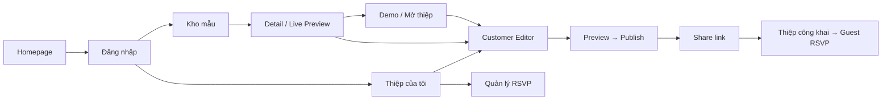

# Tiệm làm thiệp — Thiết kế FE và prototype v3

Ngày: 2026-10-10. Authority: [MASTER.md](../design/MASTER.md), gồm B01 và quyết định Customer chỉ sửa invitation data. Tài liệu này bổ sung đặc tả màn hình, không thay thế MASTER hoặc xác nhận capability chưa có. Source được đọc gồm cả working tree hiện tại; không dựa riêng vào HEAD hay task đã tick.

Đầu ra: [prototype React độc lập](../../apps/ui-prototype/README.md), fixture trong bộ nhớ, ảnh chụp review và hướng dẫn tích hợp FE thật. Backend, route production, schema và MASTER không được sửa trong lần này.

## 1. Inventory và nguồn bằng chứng

| Nhóm                 | Đã có trong source                                                                                                | Nguồn chính                                                                                                                                                                                            | Thiết kế/prototype                                                                           |
| -------------------- | ----------------------------------------------------------------------------------------------------------------- | ------------------------------------------------------------------------------------------------------------------------------------------------------------------------------------------------------ | -------------------------------------------------------------------------------------------- |
| Auth                 | Email/password, Google/Facebook, verify/resend, reset password, social onboarding, OAuth result, session recovery | [identity-access FE](../../apps/web/src/features/identity-access), [identity-access API](../../apps/api/src/modules/identity-access)                                                                   | Bảy auth screens; pending, generic confirmation, error/retry; provider actions mô phỏng      |
| Account              | Profile displayName/phoneNumber, đổi mật khẩu, đăng xuất                                                          | [profile-form](../../apps/web/src/features/identity-access/forms/profile-form.tsx), [profile API](../../apps/api/src/modules/identity-access/profile)                                                  | Form thông tin và password section; email readonly                                           |
| Admin customers      | Search/status filter, cursor, detail, lock/unlock                                                                 | [customer-management](../../apps/web/src/features/identity-access/admin/customer-management.tsx), [customer controller](../../apps/api/src/modules/identity-access/admin/customer.controller.ts)       | List responsive, detail drawer, xác nhận khóa/mở khóa                                        |
| Discovery            | Published template list, q/category/tag/cursor, cover, current revision document/sampleData/formFields            | [customer-pages](../../apps/web/src/features/invitations/customer-pages.tsx), [catalog controller](../../apps/api/src/modules/invitation-builder/http/template-catalog.controller.ts)                  | Kho mẫu, detail và demo mới ở prototype; vẫn CUSTOMER-only                                   |
| Customer invitations | Create/list/get, toàn bộ weddingData draft save, publish/unpublish                                                | [invitation API client](../../apps/web/src/features/invitations/api.ts), [invitation controller](../../apps/api/src/modules/invitations/http/invitation.controller.ts)                                 | Dashboard, guided data editor, autosave mô phỏng, publish/share milestone                    |
| Content              | Binding-derived names/photos/parents/story/events/timeline/bank                                                   | [binding catalog](../../apps/web/src/features/invitation-builder/document/binding-catalog.ts), [WeddingData](../../apps/web/src/features/invitation-builder/document/types.ts)                         | Nhóm chỉ xuất hiện theo formFields; mẫu đầu minh họa thêm parents, portrait và bank          |
| Assets               | List/upload/read/delete với owner/reference rules, JPEG/PNG/WebP ≤10MiB                                           | [asset library](../../apps/web/src/features/invitation-builder/assets/asset-library.tsx), [upload service](../../apps/api/src/modules/invitation-assets/application/upload.service.ts)                 | Drawer/sheet, local upload/select/search/retry, referenced-delete feedback                   |
| Publication          | Job PENDING/RUNNING/SUCCEEDED/FAILED, idempotency, pinned revisions, prior public snapshot                        | [publication API](../../apps/web/src/features/invitation-builder/api/operations.ts), [publication service](../../apps/api/src/modules/invitation-builder/publication/publication.service.ts)           | Mô phỏng lifecycle, dedicated success; draft/public data tách biệt                           |
| RSVP                 | Public state/submit, owner list, open/close với controlVersion                                                    | [public RSVP](../../apps/web/src/features/invitations/public-rsvp.tsx), [owner API](../../apps/web/src/features/invitations/rsvp-owner-api.ts), [RSVP API](../../apps/api/src/modules/invitation-rsvp) | Guest form qua renderer và mock transport; owner list/load-more/open-close                   |
| Admin templates      | List/create/duplicate/metadata, layers/geometry/bindings, sample data, save/publish/unpublish                     | [template pages](../../apps/web/src/features/invitation-builder/editor/template-pages.tsx), [TemplateEditor](../../apps/web/src/features/invitation-builder/editor/template-editor.tsx)                | List/filter/create/duplicate; prototype minh họa layer/geometry/optional/undo/save/lifecycle |
| Renderer             | Text, Image, Decoration, Shape, Calendar, Countdown, Map, Timeline, QRBank, RSVP                                  | [shared renderer](../../apps/web/src/features/invitation-builder/renderer/invitation-renderer.tsx)                                                                                                     | Import trực tiếp cho detail, demo, editor, fullscreen và guest                               |

Homepage trong app thật vẫn là foundation page. Token/font/primitives platform đã có trong `apps/web/src/ui/platform`; prototype reuse thay vì tạo baseline mới. [AUDIT.md](AUDIT.md) có lịch sử findings và follow-up feature 005; inventory ở đây không mở rộng các kết luận runtime của audit.

Health và internal capture là infrastructure surfaces, không đưa vào navigation hoặc thiết kế như product pages.

## 2. Art direction và nội dung

**Warm Editorial · lời mời nhỏ, ngày thật lớn.** Giao diện thoáng khi khám phá, gọn khi làm việc. Invitation là visual hero; decoration ít và có mục đích. Logo dùng nguyên asset từ `docs/branding`, không lấy màu artwork làm theme mới. Wordmark “tiệm làm thiệp” dùng Cormorant Garamond. Header chỉ giữ logo và tên web, bỏ dòng “GỬI MỘT LỜI THƯƠNG”.

| Foundation           | Quyết định                                                                                                         |
| -------------------- | ------------------------------------------------------------------------------------------------------------------ |
| Platform palette     | Giữ background `#FDFBF7`, soft `#F8F4ED`, beige `#F1EAE0`, primary `#66584A`, text `#29251F`; accent dùng tiết chế |
| Editorial typography | Cormorant Garamond cho hero, marketing headings, brand statement, wordmark                                         |
| Product typography   | Be Vietnam Pro cho dashboard/editor/admin/forms; body 16px, labels 14px                                            |
| Controls             | Input ≥44px, Button khoảng46px; outlined, visible label, focus mocha; sole input border dùng B01                   |
| Geometry             | Theo radius/spacing/container của MASTER; cover4:5, card không shadow mặc định                                     |
| Icons                | Lucide, currentColor, stroke1.75; không dùng emoji functional                                                      |
| Motion               | Opacity/transform restrained; shared easing; reduced-motion tắt nonessential animation                             |
| Templates            | Palette/font riêng trong contract của renderer, không bị ép về platform Warm Ivory                                 |

Tham khảo **cấu trúc và luồng**, không sao chép thương hiệu, copy, assets hoặc mở khóa quyền editing:

- [CineLove](https://cinelove.me/): dẫn người dùng từ gallery tới xem mẫu; Tiệm dùng composition ba thiệp riêng trong hero.
- [Vesey](https://vesey.vn/): ba bước chọn mẫu, chỉnh nội dung, chia sẻ; Tiệm dùng hướng dẫn ngắn và CTA có hierarchy.
- [Một Đời](https://motdoi.com.vn/tuy-chinh-thiep): giải thích các vùng nội dung có thể cá nhân hóa; Tiệm giữ ranh giới data editing đã duyệt, không thêm section toggles hoặc crop cho Customer.

Hero copy: **“Lời mời nhỏ. Ngày thật lớn.”** Body: “Từ những điều giản dị của hai bạn, tạo nên tấm thiệp mang một câu chuyện riêng.” CTA: “Khám phá mẫu cưới”. Brand statement: “Là cách bạn nói: Có bạn, ngày này sẽ đẹp hơn.” Không thêm giá, lượt dùng, testimonial hay cam kết thời gian chưa có dữ liệu.

Bốn mẫu minh họa thể hiện ivory/editorial, đỏ/truyền thống, xanh/thiên nhiên, đen trắng/editorial. Mẫu là fixture mới để review, không phải catalog production. Cover được biên tập từ phần đầu thiệp, không scale toàn bộ website dài vào thumbnail.

### Cập nhật layout theo thieponline.app

Tham khảo [trang demo Minimalism Nâu](https://thieponline.app/vi/mau-thiep/minimalism-nau/demo): màn lời mời trước khi mở nội dung thiệp dài. Editor riêng không đọc được qua công cụ web; bố cục accordion và edit/preview tabs lấy từ ảnh người dùng cung cấp. Giữ art direction Warm Ivory của Tiệm, không lấy dark theme hay màu tím của trang tham khảo.

- Detail chỉ có một preview mobile, bỏ cả hai lựa chọn mobile/desktop.
- CTA **Xem demo** dẫn tới `#/demo/:templateId`, một trang riêng không có global navbar/footer: thanh quay lại và dùng mẫu, màn lời mời **Mở thiệp**, nội dung cuộn dọc dùng renderer thật, và **Xem lại lời mời**.
- Demo dùng sampleData của fixture và transport preview, không dùng public snapshot của invitation hay tạo RSVP thật. Dùng mẫu từ demo mới tạo invitation đã ghim document.
- Demo giữ CUSTOMER guard cùng catalog/detail. Đây là route prototype mới, chưa tạo public published projection hoặc route production. Khi tích hợp route demo thật cần giữ quyền đọc revision/asset hiện có.
- Các toggle ẩn section, tiêu đề tự do, danh xưng, tên ngắn và thứ tự nhà trai/nhà gái trong ảnh tham khảo không được thêm vì chưa có contract tương ứng. Accordion chỉ thu gọn UI form, không ẩn nội dung thiệp.

### Popup chọn mẫu

Tham khảo [kho mẫu thieponline.app](https://thieponline.app/vi/mau-thiep) và ảnh popup người dùng cung cấp. Giữ nền, typography và spacing theo MASTER, không dùng dark glass hay CTA tím từ ảnh tham khảo.

- Card mở state chọn mẫu trên kho mẫu, không navigate tới `#/template/:id`. Card trên homepage chỉ mở khi role Customer; khách chưa đăng nhập đi tới login.
- `#/template/:id` được giữ cho bookmark/review cũ: render kho mẫu với popup mở sẵn, không còn trang detail riêng. Đóng deep link trở về `#/templates`. Review chuyển màn hình sẽ tự đóng panel trước khi mở popup.
- Preview dùng khung chữ nhật đơn giản với viền mảnh và radius theo MASTER, không mô phỏng thiết bị. Renderer và scroll container hỗ trợ focus bằng bàn phím; preview được giới hạn mobile390px; document v2 dùng flow theo feature007, document v1 vẫn scale-to-fit.
- Nút Đóng giữ cố định khi cuộn popup mobile. Popup giữ focus, đóng bằng **Đóng**, **Escape** hoặc click backdrop; khóa background scroll, restore focus về đúng card và giữ search/filter/pagination khi đóng.
- Danh sách tính năng được derive từ document/formFields: không quảng cáo ảnh không giới hạn, đa ngôn ngữ, đổi template, giá hoặc dùng thử chưa có contract.
- QR dùng helper QR hiện có, encode đúng URL demo của origin hiện tại; không phải QR ngân hàng. QR prototype chỉ mở được trên thiết bị truy cập được host đang chạy (localhost không trỏ tới máy phát triển khi quét từ điện thoại); demo vẫn cần Customer.
- **Dùng mẫu này** tạo invitation ghim document và vào editor; **Xem demo** đóng popup, mở route demo riêng. Quay lại từ demo về kho mẫu.

## 3. Sitemap và route mapping



Prototype dùng hash routes, không phải route migration:

| Product route hiện tại             | Route prototype                     | Surface                                                                               |
| ---------------------------------- | ----------------------------------- | ------------------------------------------------------------------------------------- |
| `/`                                | `#/home`                            | Marketing/homepage                                                                    |
| `/templates`                       | `#/templates`                       | Customer discovery                                                                    |
| Chưa có detail route               | `#/template/:id`                    | Deep link tương thích: kho mẫu + popup mở sẵn; card không đổi route                   |
| Chưa có demo route                 | `#/demo/:templateId`                | Trang demo riêng: lời mời → mở thiệp → renderer mobile; CUSTOMER-only                 |
| `/invitations`                     | `#/invitations`                     | Thiệp của tôi                                                                         |
| `/invitations/:id/edit`            | `#/editor/:id`                      | Guided Customer Editor                                                                |
| `/invitations/:id/rsvps`           | `#/rsvps/:id`                       | Owner RSVP                                                                            |
| `/i/:slug`                         | `#/i/:id`                           | Guest surface; mock dùng invitation ID làm slug để điều hướng, không phải wire policy |
| Bảy auth routes                    | Cùng tên sau `#`                    | Auth screens                                                                          |
| `/account`                         | `#/account`                         | Hồ sơ/password                                                                        |
| `/admin/customers`, `/:customerId` | `#/admin/customers` + drawer detail | Quản trị khách hàng                                                                   |
| `/admin/templates`, `/new`         | Cùng tên sau `#`                    | Quản lý/tạo mẫu                                                                       |
| `/admin/templates/:id/edit`        | `#/admin/editor/:id`                | Admin authoring                                                                       |

Global navigation chỉ chứa capability đang có: Mẫu thiệp, hướng dẫn tạo thiệp, Thiệp của tôi, account; Admin có quản lý mẫu/khách hàng. Editor dùng toolbar riêng. Guest không có account/session/navigation của platform. Collections, Inspirations và Favorites chưa có product destinations.

## 4. Đặc tả màn hình

### Homepage và discovery

- Desktop hero khoảng5/12 copy,7/12 showcase; thiệp giữa nổi bật, hai bên rotation nhẹ. Mobile copy trước, showcase sau; không dùng ảnh bride/groom full-screen làm hero.
- Sections: hero → phong cách minh họa → gợi ý mẫu → brand statement → ba bước → final CTA → footer. Danh mục ở homepage là nội dung biên tập, CTA dẫn vào đăng nhập; không giả vờ query catalog public.
- Grid kho mẫu đều, ưu tiên4/3/2 columns khi đủ width. Search/category/tag dựa các khả năng query hiện có; options fixture không được coi là taxonomy endpoint.
- Card có cover/name/category/tag; bấm cover hoặc tên mở popup trên kho mẫu, giữ nguyên hash URL, search/filter, pagination và vị trí cuộn. Essential action dùng được bằng touch/keyboard; hover chỉ thêm “Xem mẫu”.
- Detail là native dialog: desktop hai cột, khung preview đơn giản cuộn độc lập bên trái; tên, mô tả, nhãn và feature list bên phải; QR demo cùng hai CTA **Dùng mẫu này / Xem demo** ở cuối. Mobile xếp dọc và cuộn popup. Không có device selector hoặc popup fullscreen lồng nhau.
- Template ngừng publish/stale revision: trạng thái unavailable, đường về catalog; không tạo thiệp từ lựa chọn cũ.

### Thiệp của tôi

- CTA “Tạo thiệp”. Cover preview, tên cặp đôi từ detail fixture, trạng thái, updatedAt. Khi tích hợp, summary thật chưa có title/cover/couple names: hydrate detail có giới hạn và cache scoped theo owner, hoặc dùng fallback “Thiệp của bạn”; không giả đây là summary field.
- Context menu: chỉnh sửa, owner RSVP, xem public/copy link khi đang PUBLISHED. Không thêm invitation duplicate/delete.
- DRAFT, PUBLISHED, UNPUBLISHED có nhãn tiếng Việt và text/icon; không dùng màu làm tín hiệu duy nhất.
- Empty: “Chưa có thiệp nào” + giải thích + “Khám phá mẫu”. Không đặt analytics placeholders.

### Customer Editor

- Toolbar: back, tên thiệp lấy từ nội dung, local save status, lưu thủ công, xuất bản. Status không toast mỗi lần autosave.
- Layout theo ảnh editor thieponline.app người dùng cung cấp: form một cột, max-width720px gồm các accordion cards; nhóm “Thông tin cơ bản” mở ban đầu. Không dùng rail hoặc panel bên cạnh.
- Header sản phẩm giữ logo và tên web, tiếp theo toolbar sticky có back/tên mẫu, tabs **Chỉnh sửa / Xem trước**, save status, lưu và xuất bản.
- Desktop dùng hai cột cho các field ngắn trong cùng card; mobile xuống một cột. Các nhóm mở inline bằng native details/summary, không dùng content sheet. Media vẫn dùng dialog riêng; không render field DOM trùng khi đổi tab.
- “Xem trước” thay form bằng nội dung bản nháp trong canvas mobile390px; đổi về “Chỉnh sửa” giữ local edits và autosave. Toàn màn hình là lựa chọn xem thêm, không có device selector.
- Các nhóm: Hai bạn/gia đình, Hình ảnh, Lễ & tiệc, Câu chuyện, Timeline, Mừng cưới và Chia sẻ; render theo `formFields` của pinned document. Các event dùng đúng eventKey mà template bind; fixture hiện chỉ minh họa reception.
- Photos chọn/upload asset IDs; không có crop/focal, geometry, font/color hay thiết kế. Timeline thêm/xóa entries, không phải reorder section. Bank controls chỉ xuất hiện khi mẫu hỗ trợ.
- Autosave mock:800ms idle, validate bằng validator hiện có, lưu toàn bộ weddingData. Lỗi/conflict giữ local edits và đưa ra recovery. Đây là thiết kế orchestration; production hiện có manual save.
- Khi tích hợp autosave thật: serialize saves, cập nhật expectedVersion từ response, không ghi đè edits mới bằng response cũ, giữ owner/resource lifetime guard hiện có. Conflict không auto-merge; yêu cầu người dùng xem bản server trước khi quyết định gửi lại. Không retry bằng version đoán.
- Publish: save dữ liệu hợp lệ trước, snapshot request riêng, PENDING → RUNNING → SUCCEEDED hoặc FAILED. Success là dialog có copy link/xem thiệp. Public dùng snapshot gần nhất, không render draft trực tiếp.
- Ngừng xuất bản cần confirmation với hậu quả rõ; bản nháp vẫn giữ. Chặn hoặc xác nhận rời editor nếu còn edits chưa lưu khi tích hợp.

### Media library

- Desktop drawer; mobile accordion/tabs. Header có tên/close; initial focus trong surface, Escape, Tab containment, return/fallback focus.
- Upload local feedback, search, image grid, chọn ảnh và delete feedback. Error ở nơi thao tác, retry không mất field context.
- MIME/kích thước cơ bản được kiểm trong prototype. Production cần giữ toàn bộ API pipeline: decoded MIME, animation/multipage, EXIF/metadata strip, normalize/resize, owner/reference authorization.
- Asset trong draft/public snapshot không được xóa. Không dùng storage keys hay public URL giả làm quyền đọc ảnh private.

### Public invitation và RSVP

- Shared renderer với published data; không session/account chrome. Review strip nằm ngoài product surface và chỉ tồn tại trong prototype.
- PublicRsvp được reuse nguyên logic UI, chỉ thay transport bằng adapter mock. Form: name, attendance, partySize, message; source validation và generic recovery giữ nguyên.
- Owner: open/close state, list, load-more, refresh; desktop row/card hierarchy và mobile cards. Không suy diễn tổng số khách từ một page hoặc thêm export/analytics.
- Thay open/close thật dùng `expectedControlVersion`; draft save/publish dùng editVersion. Hai version không hoán đổi.

### Auth/account

- Desktop editorial story + form; mobile form-first, bỏ illustration phụ. Form controls dùng shared primitives.
- Register chỉ email/password đúng contract. Verify/resend/reset/onboarding có confirmation generic, không xác nhận email có tồn tại hay gửi email thành công chỉ từ mock.
- Proof thật nằm trong fragment hygiene của implementation hiện có; không thêm token textbox hoặc đưa proof vào query/log. OAuth buttons mô phỏng các màn hình kết quả, không chạy provider thật.
- Account: displayName, phoneNumber chưa xác minh, readonly email, password section, signout. Khi tích hợp giữ password-change session revocation và recovery lifetime.

### Admin

- Customer list: q/status/cursor thật; email/tên/status; detail drawer có identity, ngày tạo và lock/unlock. Decision surface dùng confirmation, không nested modal.
- Template list: q/category/tag/status, create, duplicate. Duplicate mẫu khác với duplicate invitation Customer.
- Authoring: toolbar save/undo/redo/preview/publish; components/layers bên trái, canvas giữa, properties/bindings contextual. Mobile chuyển theo task/tab, vẫn có geometry bằng field input làm phương án thay drag.
- Properties specification theo component: Text fontId/size/weight/alignment, Image fit và positionX/Y, Shape fill/border, widget content, appearance/geometry, optional/hidden/locked theo contract. Binding panel chọn source/target/eventKey hợp lệ từ catalog, hiển thị lỗi theo node.
- Asset tooling gồm template library, coverAssetId override, image focal/crop presentation; sample datasets tách khỏi invitation data. Không đem tooling này sang Customer.
- Prototype hiện minh họa layer selection, geometry/optional, undo, tên mẫu, save và lifecycle. Components, drag/resize, binding/crop panel đầy đủ và trusted publication là phần engine có sẵn để tích hợp, không được xây lại cho bản review này.

## 5. Interface boundaries và blockers

Public APIs/types production không đổi. Prototype có types/state riêng cho review, import TemplateDesign/WeddingData thật và giữ mock presentation metadata ngoài DTO.

| Behavior   | Contract cần giữ khi tích hợp                                                                                                   |
| ---------- | ------------------------------------------------------------------------------------------------------------------------------- |
| Catalog    | CUSTOMER-only; `q,category,tag,limit,cursor`; chỉ current published revision                                                    |
| Create     | `templateId,designRevisionId`; pin revision;409 TEMPLATE_UNAVAILABLE cần reload selection; không có create-idempotency contract |
| Draft save | Whole weddingData + expectedVersion; không gửi document/style/bindings từ Customer                                              |
| Publish    | Idempotency-Key, job receipt/operation polling, giữ key/payload khi outcome uncertain;202 chưa thành công                       |
| Public URL | Lấy từ refreshed summary/detail; không đoán publicUrl từ operation result hoặc invitation ID                                    |
| Assets     | Bearer/resource policy, authenticated bytes/blob lifecycle, no-store và revoke object URLs                                      |
| RSVP       | Owner controlVersion, public submit idempotency, closed/unavailable/rate-limit states                                           |
| Session    | Principal/resource disposal và stale-completion guards từ code hiện có; prototype role selector không thay thế session thật     |

```text
BLOCKED: Backend capability required
Feature: Anonymous catalog/detail/live-preview/cover
Required capability: Safe read-only projection cho published templates và assets
Affected UI: Marketplace trước login
Suggested contract: Review public published projection riêng; không mở draft/private reads
Reason: Catalog/revision hiện CUSTOMER-only; cover/assets cần quyền đọc
```

```text
BLOCKED: Backend capability required
Feature: Rich InvitationSummary và management actions
Required capability: Owner-scoped title/cover metadata, dataset-wide status filters,
                     duplicate/delete nếu được đưa vào future scope
Affected UI: Dashboard cards/filter/context menu
Suggested contract: Review summary projection/actions riêng, giữ lifecycle/reference rules
Reason: Summary hiện chỉ có IDs/status/versions/URL/timestamps/RSVP state;
        không có Customer duplicate/delete endpoints
```

```text
BLOCKED: Backend capability required
Feature: Favorites, persisted collections/inspiration, pricing, analytics,
         guest export, album nhiều ảnh và discovery filters mở rộng
Required capability: Domain resources, query/schema và quyền truy cập tương ứng
Affected UI: Navigation, marketplace, editor và dashboard mở rộng
Suggested contract: Review riêng từng capability trước khi thêm controls
Reason: Không có contracts tương ứng trong source đã đọc
```

Customer design editing là **PROHIBITED**, không phải missing capability cần bổ sung. Không tạo endpoint/DTO để Customer đổi pinned design.

## 6. Review, acceptance và bàn giao

Chạy theo [README prototype](../../apps/ui-prototype/README.md). Review panel chọn 20 destinations và các trạng thái; popup detail, media, fullscreen và publish success là surfaces bổ sung trong luồng.

| Kiểm tra      | Cách kiểm                                                                                                          |
| ------------- | ------------------------------------------------------------------------------------------------------------------ |
| Build/types   | TypeScript noEmit + Vite production build                                                                          |
| Main flows    | Catalog/filter/create, autosave/publish/public snapshot, guest RSVP/open-close, Admin authoring pinning            |
| Role boundary | Anonymous bị đưa về login, Admin-only screens, Customer không có design controls                                   |
| Responsive    | Từng destination ở360/375/390/430/768/1440px; không horizontal overflow                                            |
| Interaction   | Media keyboard containment/Escape/return focus; mobile accordion/tabs; error/conflict giữ input                    |
| Network       | Guest lifecycle không gửi request tới API/external services                                                        |
| Visual        | Desktop/mobile captures, local fonts/logo/images, cover ratio, restrained hierarchy                                |
| Accessibility | Kiểm actual platform contrast, keyboard/focus, tăng root font/reduced-motion; giới hạn embedded renderer ghi riêng |

Ảnh review nằm trong [prototype-screenshots](prototype-screenshots). Đây là screenshots của prototype, không phải production hoặc visual regression baseline tự động.

Kết quả kiểm tra ngày 2026-10-10:

- Production build kèm TypeScript noEmit đạt; kiểm tra Prettier đạt.
- Chromium: **21/21 tests đạt**, gồm 20 destinations tại sáu viewport, luồng tạo/lưu/xuất bản/RSVP, giữ public snapshot và pinned design, lỗi/conflict, xác nhận rời bản chưa lưu, keyboard dialog, popup selection/backdrop/Escape/return focus và mobile accordion/tabs.
- Bốn fixture document và weddingData mẫu hợp lệ theo validator production. Phép đo renderer với mẫu đầu không có canvas/content overflow sau khi font và ảnh đã sẵn sàng.
- Contrast từ computed styles: main text/ivory **14.74:1**, muted text/ivory **4.87:1**, chữ trắng/primary **6.86:1**, input border/white **6.86:1**. Đây là những cặp platform đã kiểm, không bao gồm tất cả template/widget.
- Mười hai ảnh chụp đã cập nhật; kiểm tra trực quan homepage mobile, gallery desktop, editor desktop và popup desktop/mobile. Guest flow không gửi request tới API hoặc external service trong browser test; demo có kiểm guard, mở/đóng lời mời và dùng mẫu.

### Giới hạn cần giữ rõ

- Canvas v1 cố định390px, typography/geometry tuyệt đối; scale-to-fit không phải reflow. Prototype đã dùng contract v2 của feature007 cho ba mẫu đầu; mẫu thứ tư giữ v1. Không tự chuyển template/invitation cũ.
- Renderer dùng hai Noto font IDs hiện có; platform dùng Cormorant/Be Vietnam Pro. Không mở font schema mới chỉ để mẫu minh họa đẹp hơn.
- Markup heading/image semantics và controls trong widget hiện có cần audit riêng; chưa chứng nhận WCAG2.2AA cho published invitations.
- Kiểm tăng root font lên 32px là mô phỏng kích thước chữ; chưa kiểm browser zoom 200% hoặc tất cả công nghệ hỗ trợ.
- Prototype không chạy DB/storage/auth cookies/providers/retention/render queue, và không verify race conditions của production. Worker/revision/CAS behavior thật phải dùng existing test gates khi tích hợp.
- Data review trong bộ nhớ, reload/reset phục hồi fixture. Clipboard chứa link prototype; publicUrl mock không phải link gửi khách thật.

Thứ tự tích hợp FE thật: foundations/navigation → Customer catalog/detail/dashboard → guided editor/media/publish recovery → public RSVP → account/auth refinement → Admin chrome/properties. Giữ tests/lifetime guards hiện có, xác minh từng phase với contracts thật; public discovery chỉ mở khi có capability được duyệt.

## 7. Production responsive invitation layout — feature007

Document1 giữ renderer canvas390px và scale legacy. Document2 dùng section stack/grid theo chiều cao nội dung; flow leaf không lấy tọa độ canvas. Artwork nằm trong lớp riêng, clipped, aria-hidden và không nhận pointer. Host thực dưới768px cap480px; từ768px cap900px, căn giữa. Customer preview và popup mobile cap390px; Admin có preview390/900. Platform design tokens và MASTER giữ nguyên.

Admin tạo mẫu2, thêm/sắp xếp section và leaf, chọn grid/typography/artwork, binding và asset được cấp quyền, undo/redo, save/reload và duplicate. Chuyển mẫu1 là thao tác dựng lại section trong mẫu2 riêng; không tự đổi tọa độ hay repin invitation. Customer chỉ nhập WeddingData1; không có device/layout controls, album động hoặc audio mới. Album hiện tại là các Image leaf tĩnh.

V2 dùng heading semantics, alt cho ảnh nội dung, controls có focus/target44px và flow giữ RSVP state khi resize. Preview RSVP mô phỏng form inert để khớp geometry với public; guest dùng endpoint thật. Fonts/images phải sẵn sàng trước đo/parity/publication. All gate ba browser kiểm host360/375/390/430/767/768/900/1024/1440, parity≤1px, keyboard và text200%; đây không phải chứng nhận toàn bộ WCAG hoặc mọi template tùy ý. Xem [validation](../../specs/007-responsive-invitation-layout/validation.md). Các giới hạn prototype ở mục6 vẫn áp dụng cho prototype.

### Prototype responsive — cập nhật 2026-10-11

- Tái sử dụng `SupportedTemplateDesign`, `resolveDesign`, `validateSupportedTemplateDesign` và `InvitationRenderer` của feature007. Không tạo renderer/CSS layout song song.
- `responsive-fixtures.ts` re-author ba fixture thành section v2 có bindings/data/assets chung giữa mobile và desktop. Mẫu thứ tư giữ v1; reload/reset phục hồi fixture.
- Demo độc lập và Guest có host adaptive tối đa900px; container >=768px chọn desktop, nhỏ hơn chọn mobile tối đa480px. Header/platform chrome không đổi container/token của MASTER.
- Popup chọn mẫu và Customer editor/fullscreen preview giữ host mobile390px. Mobile preview khớp output public khi so cùng chiều rộng, không ép public desktop thành mobile.
- Preset information tối đa420/560px, story480/640px, form400px; hero full width, album một/hai cột. Nội dung có chiều cao tự động, không scale toàn canvas390 lên900.
- Admin prototype v2 có review390/900px, chỉnh preset/khoảng cách/số cột desktop, undo và save/publish mô phỏng. Invitation đã tạo tiếp tục giữ document đã ghim khi sửa catalog.
- Đây là tích hợp UI prototype vào contract007 đã tồn tại, không triển khai lại feature007 hoặc xác nhận production deployment. Phương án nghiên cứu ban đầu ở DESKTOP-900-PLAN.md được thay bằng implementation007 cho contract hiện hành.

Kiểm tra tích hợp007 trên prototype: TypeScript và production build đạt; Prettier đạt; toàn bộ23 browser tests đạt. Coverage bổ sung gồm 767/768px, chiều rộng thực900px, album đổi cột, mobile host trong popup/editor trên desktop, giữ RSVP state khi resize và mẫu v1. Bộ ảnh review bổ sung demo desktop, Guest desktop và Admin authoring desktop; đã kiểm trực quan popup và demo900px. Không chạy lại backend/publication gates vì không sửa source production.

Màn mở thiệp desktop dùng nền beige toàn màn hình, card giữa trang rộng600px, hoa SVG trang trí hai góc, dấu trái tim, tên hai bạn/ngày cưới/lời mời và nút Mở thiệp. Toolbar demo ẩn khi mở lời mời desktop và xuất hiện sau khi mở thiệp. Mobile giữ bố cục dọc kèm ảnh; nội dung thiệp v2 sau khi mở vẫn tối đa900px.

### Khu vực tài khoản — cập nhật 2026-10-11

Tham khảo cấu trúc menu avatar/sidebar/overview từ ảnh CineLove do chủ sản phẩm cung cấp. Giữ visual language Warm Editorial của MASTER; không đưa màu xanh/tím, banner partner, hạn mức Free, ví, quà tặng hoặc favorites chưa có contract vào prototype.

- Avatar mở disclosure gồm thông tin hồ sơ, Tổng quan, Thiệp của tôi, Thông tin cá nhân, Tạo thiệp mới và Đăng xuất. Escape đóng và trả focus về avatar; click ngoài đóng. Admin có lối vào quản lý mẫu và hồ sơ.
- Route `#/overview` dành cho Customer, cùng sidebar với `#/invitations` và `#/account`. Sidebar chuyển thành điều hướng ngang trên mobile. Editor, demo và public invitation giữ interaction model riêng.
- Overview gồm lời chào, số thiệp/đang xuất bản/bản nháp và tạm dừng, danh sách tiếp tục chỉnh sửa và lối vào quản lý RSVP. Số liệu lấy từ state prototype, không giả lập usage quota/gói dịch vụ hoặc analytics views.
- Hồ sơ lưu trong bộ nhớ Context để tên/email nhất quán giữa form, avatar, sidebar và overview. Reset/reload phục hồi seed. Không gọi API, không xác nhận production account persistence.
- Form hồ sơ và đổi mật khẩu giữ các trường, trạng thái lỗi/thành công hiện có; sidebar thêm bố cục, không thay backend contract.

Kiểm tra khu vực tài khoản: build/TypeScript và Prettier đạt; toàn bộ24 browser tests đạt, sau chỉnh CSS mobile chạy lại3 checks liên quan đều đạt. Ảnh review gồm overview desktop/mobile, hồ sơ desktop và menu avatar. Kiểm trực quan phát hiện và đã sửa tên thiệp bị ép hẹp trên mobile; keyboard Escape/focus restore, click ngoài, lưu hồ sơ xuyên route, đăng xuất và guard overview có browser coverage.
