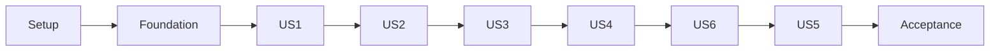

# Tasks: Invitation Builder

**Input**: [plan.md](plan.md), [spec.md](spec.md), [research.md](research.md), [data-model.md](data-model.md), [contracts/](contracts/http-api.md), [quickstart.md](quickstart.md).

**Prerequisites**: Requirements checklist đã đạt; chạy `$speckit-analyze` sau task generation và giải quyết CRITICAL/HIGH findings trước implementation theo constitution. Không có task nào được đánh dấu hoàn tất bởi lệnh này.

**Tests**: Có test tasks vì spec yêu cầu acceptance scenarios/SC kiểm chứng được và constitution bắt buộc database/HTTP contract coverage. Tests story được viết trước implementation tương ứng sau khi tooling/fixtures đã có; ghi RED do hành vi chưa xây, không coi thiếu dependency hoặc suite không chạy là RED có giá trị. Chỉ chạy gate xanh khi implementation cần thiết đã hoàn tất.

**Organization**: P1 theo thứ tự US1 → US2 → US3 → US4 → US6; P2 US5 tiếp theo, sau đó nghiệm thu chung. ID US5/US6 giữ nguyên spec. Story có fixture riêng để kiểm độc lập nhưng không giả vờ không có dependency.

## Format và đường dẫn

- Mỗi task theo `- [ ] Txxx [P?] [USn?] mô tả + đường dẫn`.
- Đường dẫn tương đối từ repository root; tên file chưa tồn tại là đích cần tạo. Không import runtime source của app khác vào app hoặc root scripts.
- `[P]` chỉ áp dụng cho các task cùng cohort có prerequisites đã hoàn tất và file không xung đột; bảng parallel phía dưới là danh sách nhóm được phép. Task khác chạy theo dependencies; commit/format/package/migration registration không chạy song song trên cùng file.
- `Depends` là predecessor bắt buộc, ngoài việc mọi story cần nền tảng. Case kiểm chứng ghi evidence vào `specs/004-invitation-builder/validation-results.md`; không thay đổi marker của reviewer checklist trong implementation.
- Test-only `jsqr@1.4.0` bổ sung công cụ decode cho phép thử QR đã có trong plan; [manifest chính chủ](https://raw.githubusercontent.com/cozmo/jsQR/master/package.json) xác nhận version. Không thêm tính năng sản phẩm hoặc QR provider.

## Phase 1: Setup — tooling, fixtures và compatibility

**Goal**: Chuẩn bị dependencies, runner cách ly và phép thử stack trước khi xây tính năng.

**Independent Test**: Runner thất bại rõ khi thiếu test/DB, tự cleanup; fixture Next production chứng minh Craft/Moveable hoạt động với React đã khóa.

### Implementation

- [X] T001 Đọc apps/web/AGENTS.md và installed Next guides; ghi Git/dependency baseline, phạm vi được duyệt và các bước chưa chạy trong specs/004-invitation-builder/validation-results.md; không tự đánh dấu PASS cho sản phẩm.
- [X] T002 Pin Craft 0.2.12, react-moveable 0.56.0, qrcode 1.5.4 và @playwright/test 1.63.0 vào apps/web/package.json; Playwright 1.63.0/sharp 0.35.5/runtime AJV vào apps/api/package.json; thêm jsqr 1.4.0 chỉ cho web test decode ảnh; cài dependencies và cập nhật pnpm-lock.yaml, giữ nguyên React/Next hiện hành; pin exact @aws-sdk/client-s3 trong API và verify/pin MinIO server/client distribution/image digests theo contracts/storage.md, ghi evidence version/license/setup trước storage gates; Depends: T001.
- [X] T003 [P] Tạo registry font bất biến và tám face Noto Sans/Noto Serif Việt ngữ 400/700 thường/nghiêng, checksum/license tại apps/web/src/features/invitation-builder/renderer/font-registry.ts và apps/web/public/fonts/invitation-builder/manifest.json; không dùng runtime font provider; Depends: T002.
- [X] T004 [P] Tạo corpus dùng chung dạng dữ liệu tại specs/004-invitation-builder/contracts/fixtures/manifest.json cùng fixtures valid/invalid/optional/QR, reviewed bank catalog tại specs/004-invitation-builder/contracts/fixtures/banks.json và ảnh raster có license; đóng gói cùng bank snapshot vào apps/api/src/modules/invitation-builder/domain/bank-catalog.json và apps/web/src/features/invitation-builder/document/bank-catalog.json; định danh rõ input/expected, 110-node performance và 200-node maximum fixtures; không thêm root runtime business package; Depends: T002.
- [X] T005 Cấu hình apps/web/playwright.config.ts và apps/web/e2e/invitation-builder/fixtures.ts cho Chromium/Firefox/WebKit, baseURL từ runner, artifact paths cách ly; cài pinned browsers/system dependencies trước compatibility gate; loại e2e/Next-fixture khỏi apps/web/vitest.config.ts để Vitest không chạy Playwright tests; Depends: T003, T004.
- [X] T006 Thêm strict builder env validation tại apps/api/src/config/invitation-builder.environment.ts và server-only API_INTERNAL_BASE_URL tại apps/web/src/config/server-env.ts; cập nhật apps/api/.env.example, apps/web/.env.example; không cần API/web đang chạy khi build; BUILDER_S3_* theo storage contract, bỏ BUILDER_ASSET_ROOT; thêm pinned MinIO service/health/persistent volume vào compose.yaml và explicit API-owned apps/api/scripts/builder-storage-init.cjs, root builder:storage:init orchestration; init ≤60s, private dev/test buckets, scoped non-root identities, root credentials chỉ thuộc infra; infrastructure sẵn trước T012; document/validate sáu BUILDER_TEST_S3_* trong API env example; provisioning nhận dev/test credentials riêng từ local config hoặc CI secrets, tạo hai identity giới hạn bucket/prefix tương ứng, không log secrets; Depends: T002.
- [X] T007 Thêm ephemeral fixture config tại apps/api/scripts/with-test-builder.cjs và apps/api/test/fixtures/invitation-builder/runtime.ts; hỗ trợ BUILDER_TEST_SCHEMA=builder_test_<uuid> trong apps/api/src/infrastructure/database/data-source.ts với NODE_ENV=test, giữ nguyên kiểm tra IAM_TEST_SCHEMA và cấm chọn đồng thời; cập nhật apps/api/test/identity-fixture.ts và apps/api/scripts/with-test-iam.cjs để các IAM suites nhận builder test config cách ly, cấp test S3 config/prefix và scratch riêng, cleanup chỉ prefix/scratch tự tạo, IAM unit/build không cần MinIO sống, không đổi semantics IAM; map sáu test variables sang BUILDER_S3_* chỉ trong child env, xóa inherited session token, prefix tests/<uuid>/ do runner cấp; không fallback dev credentials/AWS chain, không đổi parent env; Depends: T006.
- [X] T008 Tạo scripts/builder-validate.mjs và root package.json script validate:builder: hỗ trợ --phase theo quickstart và --story US1|US2|US3|US4|US5|US6 theo bảng selector bên dưới; explicit BUILDER_TEST_DATABASE_URL và BUILDER_TEST_S3_BUCKET khác dev bucket, random schema/tests/<uuid>/ object prefix/scratch/ports, deadline, process-group cleanup, required-file manifest, union dependency suites chạy một lần/selector, không skip suite chưa có; storage suites dùng real MinIO, scoped test credentials; bounded paginated cleanup chỉ prefix của run, không xóa bucket/volume, báo cleanup failure; hardDeadline=startedAt+budget, workDeadline=hardDeadline−30s; giữ nguyên tổng deadline, reserve tối đa 30s cho dừng writers và cleanup; timeout SDK=min(10s, cleanup budget còn lại), không retry sau deadline; cleanup thiếu trả nonzero và cleanup: FAILED với bucket/prefix/tài nguyên còn sót hoặc unknown cùng sanitized reason; không bảo đảm SIGKILL/host shutdown; Depends: T005, T007.

### Verification

- [X] T009 Kiểm chứng timeout/signal/child failure, thiếu file/DB, isolation, không xóa tài nguyên ngoài ownership và story dependency selection trong scripts/tests/builder-validate.test.mjs; thêm safe env/no-secret tests tại apps/api/test/unit/invitation-builder/environment.spec.ts và apps/web/tests/invitation-builder/environment.test.ts; kiểm thiếu MinIO/test bucket/credentials, không fallback dev bucket và timeout/pagination/cleanup failures; test thiếu/sai sáu test variables, child-only mapping và session-token clearing, test identity không đọc dev bucket, hai run không cleanup lẫn nhau; workload hết giờ vẫn vào cleanup, storage treo không vượt hardDeadline, cleanup lỗi không báo PASS dù tests đạt; Depends: T008.

### Implementation

- [X] T010 Cập nhật scripts/scope-check.mjs và scripts/tests/scope-check.test.mjs để cho phép Invitation Builder theo feature 004, tiếp tục chặn payment/VNPay; không xóa guard chỉ để vượt kiểm tra; Depends: T001.
- [X] T011 Tạo isolated production Next fixture tại apps/web/tests/fixtures/builder-compat/app/page.tsx và apps/web/e2e/invitation-builder/compatibility.spec.ts: StrictMode remount, chọn target, rotated resize ở zoom 0.5/1/2, một bước undo và serialize round-trip; runner build/start fixture riêng, không tạo production test route; Depends: T008, T002.

### Verification

- [X] T012 Chạy setup gate và ghi kết quả/cleanup vào specs/004-invitation-builder/validation-results.md; compatibility fail phải sửa adapter hoặc cập nhật thiết kế có căn cứ, không tự downgrade React hay bỏ test; verify MinIO provisioning/readiness/private buckets và pinned versions trước foundation; Depends: T003, T004, T009, T010, T011.

**Checkpoint**: `pnpm validate:builder --phase setup` sau toàn bộ predecessor; mỗi gate phải có timeout/cleanup theo runner contract.

## Phase 2: Foundational — contracts, persistence và resource boundaries

**Goal**: Hoàn thành nền tảng dùng chung cho các story; chưa cung cấp endpoint hoặc UI giả cho nghiệp vụ chưa triển khai.

**Independent Test**: Schema apply/reapply và rollback disposable thành công; document malformed, asset scope và race delete/reference bị kiểm soát.

### Implementation

- [X] T013 Định nghĩa TemplateDesign/WeddingData/ResolvedScene, limits và property matrix tại apps/api/src/modules/invitation-builder/domain/document.types.ts và apps/web/src/features/invitation-builder/document/types.ts theo contracts/document-format.md; giữ wire schema version 1; Depends: T012.
- [X] T014 [P] Triển khai JSON/typed validation, allowlisted nodes/props/bindings, partial draft versus publish errors và canonical hashing tại apps/api/src/modules/invitation-builder/domain/document.validator.ts và apps/api/src/modules/invitations/domain/wedding-data.validator.ts; 1 MiB/256 KiB, tree integrity và finite geometry; Depends: T013.
- [X] T015 [P] Triển khai Zod schemas và safe issue paths tại apps/web/src/features/invitation-builder/document/schema.ts và apps/web/src/features/invitations/wedding-data.schema.ts, bám cùng corpus và không import API runtime; Depends: T013.
- [X] T016 Thêm core entities cho templates/revisions/invitations/assets và reference tables tại apps/api/src/modules/invitation-builder/domain/entities.ts, apps/api/src/modules/invitations/domain/entities.ts, apps/api/src/modules/invitation-assets/domain/entities.ts; tạo apps/api/src/infrastructure/database/migrations/20261001000100-InvitationBuilderCore.ts với cyclic FK đúng thứ tự, immutable triggers, CHECK/index; thêm asset_storage_writes entity/table với token/deadline/state/index cho fenced PutObject, job FK bổ sung ở migration jobs; Depends: T014.
- [X] T017 Định nghĩa publication jobs/lease/receipt/job asset refs tại apps/api/src/modules/invitation-builder/publication/entities.ts và migration apps/api/src/infrastructure/database/migrations/20261001000200-InvitationPublicationJobs.ts; partial unique active-job indexes, XOR target và 24h terminal receipt retention; bổ sung FK asset_storage_writes.job_id sau khi publication_jobs tồn tại; Depends: T016.
- [X] T018 Đăng ký core entities/modules/providers trong apps/api/src/infrastructure/database/data-source.ts, apps/api/src/app.module.ts và apps/api/src/modules/invitation-builder/invitation-builder.module.ts, apps/api/src/modules/invitations/invitations.module.ts, apps/api/src/modules/invitation-assets/invitation-assets.module.ts; giữ explicit migrations, chưa đăng ký worker cho đến khi có implementation; Depends: T017.
- [X] T019 Tạo AssetStore port và S3-compatible adapter tại apps/api/src/modules/invitation-assets/domain/asset-store.port.ts và apps/api/src/modules/invitation-assets/infrastructure/s3-asset-store.ts: AWS SDK v3 Put/Get/Head/Delete/List, immutable keys, private bucket/prefix, SHA-256 không dựa ETag, write-intent PutObject/READY fencing, timeout 10s/2 attempts trong parent deadline, no rename, no browser presigned URLs; services không phụ thuộc MinIO SDK; Depends: T018.
- [X] T020 Triển khai transactional scope/reference service tại apps/api/src/modules/invitation-assets/application/asset-reference.service.ts: lock UUID order, READY-only, full draft refs versus public visible set, direct cover/thumbnail usages trước tombstone; template/customer/admin-assistance scopes theo contract; tạo protected byte read và basic READY asset selection tại apps/api/src/modules/invitation-assets/http/assets-read.controller.ts, đăng ký trong invitation-assets.module.ts để US1 đọc fixture assets trước upload UI; Depends: T019.
- [X] T021 Tạo resource policies và version conflict helpers tại apps/api/src/modules/invitations/authorization/invitation.policy.ts và apps/api/src/modules/invitation-builder/authorization/template.policy.ts; owner từ DB, guest/other-owner denial, explicit active ADMIN/target CUSTOMER assistance checks; giữ IAM token semantics; Depends: T018.
- [X] T022 Mở rộng apps/api/src/common/errors/problem.filter.ts và apps/api/src/common/errors/public-problem.exception.ts bằng builder code allowlist/safe issues; cấu hình scoped JSON/multipart limits và CORS DELETE/Idempotency-Key/Location trong apps/api/src/main.ts, giữ IAM limits và exact-origin credentials; Depends: T021.
- [X] T023 Tạo test DB/entity builders và race barriers tại apps/api/test/fixtures/invitation-builder/database.ts và apps/api/test/fixtures/invitation-builder/candidates.ts; seed tài khoản bằng test fixtures hiện hữu, không thêm production auth bypass; nhận schema/test bucket/prefix/scratch do runner sở hữu, seed bytes qua S3 adapter; Depends: T020, T022.

### Verification

- [X] T024 Viết và chạy schema corpus parity, migrated constraints/immutability, asset reference/delete và policy tests trong apps/api/test/contract/invitation-builder/document.spec.ts, apps/api/test/integration/invitation-builder/foundation.spec.ts và apps/web/tests/invitation-builder/document.test.ts; kiểm empty/IAM-only baseline và repeat migration no-op; real MinIO round-trip/hash, private policy, bad credentials/missing key/outage/timeout và namespace isolation tại apps/api/test/integration/invitation-builder/storage.spec.ts; kiểm write-intent expired writer không commit; Depends: T023, T015.
- [X] T025 Chạy foundation gate; kiểm API/web build riêng không cần app kia và ghi evidence vào specs/004-invitation-builder/validation-results.md; block story work nếu core constraints/cleanup còn fail; Depends: T024.

**Checkpoint**: `pnpm validate:builder --phase foundation` sau toàn bộ predecessor; mỗi gate phải có timeout/cleanup theo runner contract.

## Phase 3: User Story 1 — Admin thiết kế và lưu mẫu (P1)

**Goal**: Admin tạo/open/duplicate/save mẫu, chỉnh primitive elements/properties/layers và history.

**Independent Test**: Với fixture assets đã READY, tạo Text/Image/Decoration/Shape, sửa/undo/redo, save/reopen/duplicate; document và metadata giữ nguyên, stale save không ghi đè.

### Tests

- [X] T026 [P] [US1] Viết draft/metadata/duplicate/role/CAS contract cases tại apps/api/test/contract/invitation-builder/template-draft.spec.ts; verify safe failures và references; draft mới trả coverUrl:null, cover selection ưu tiên override → retained revision thumbnail → null bằng DB fixtures, không đòi publish/asset-upload chưa xây. [FR-001, FR-002, FR-004, FR-007, FR-025]; Depends: T025.
- [X] T027 [P] [US1] Viết canonical round-trip, UUID/root-parent adapter, history cancel/single gesture, locked/hidden/order tests tại apps/web/tests/invitation-builder/editor-state.test.tsx. [FR-005, FR-006, FR-008, FR-009, FR-010]; Depends: T025.
- [X] T028 [P] [US1] Viết authoring, property matrix, keyboard, navigation-dirty và two-tab conflict scenarios tại apps/web/e2e/invitation-builder/authoring.spec.ts; fixture assets được seed vào DB/storage và chọn qua basic READY asset selection; không cần upload UI US3. [FR-011, FR-012, FR-013]; Depends: T025.

### Implementation

- [X] T029 [US1] Triển khai create/list/get/save/metadata/duplicate transaction và ref sets tại apps/api/src/modules/invitation-builder/application/template-draft.service.ts; duplicate remap IDs, draft-only và caller createdBy; metadata cover locks READY asset; summary/detail trả coverUrl nullable theo override → retained revision thumbnail → null; Depends: T026, T027, T028.
- [X] T030 [US1] Expose admin template draft/metadata/duplicate endpoints và DTO/Swagger tại apps/api/src/modules/invitation-builder/http/template-draft.controller.ts; add provider/controller registration vào apps/api/src/modules/invitation-builder/invitation-builder.module.ts, giữ authorizations phía server; Depends: T029.
- [X] T031 [US1] Tạo typed API client/error mapping tại apps/web/src/features/invitation-builder/api/client.ts dùng session refresh hiện hữu; không tự retry mutation bằng version/payload mới, bảo toàn dirty state khi lỗi; Depends: T030.
- [X] T032 [US1] Tạo adapter/registry/mutation commands tại apps/web/src/features/invitation-builder/editor/craft-adapter.ts và apps/web/src/features/invitation-builder/editor/commands.ts: UUID creation/remap, ROOT.parent null import/omitted export, flat children, một nguồn z-order, history đúng gesture; Depends: T031, T027.
- [X] T033 [US1] Triển khai Text/Image/Decoration/Shape display components và fixed canvas tại apps/web/src/features/invitation-builder/renderer/primitives.tsx và apps/web/src/features/invitation-builder/renderer/canvas.tsx; đầy đủ TextStyle, object-fit/position, shadow/border/padding matrix và font registry; không Craft hooks; Depends: T032.
- [X] T034 [US1] Tạo transient Moveable adapter tại apps/web/src/features/invitation-builder/editor/geometry-controls.tsx: inverse scale, center rotation, opposite resize anchor, single setProp commit, cancel rollback, disable conflicting Craft drag/save/publish, respect lock. [FR-006, FR-008]; Depends: T033.
- [X] T035 [P] [US1] Xây panel primitives/numeric geometry tại apps/web/src/features/invitation-builder/editor/properties-panel.tsx, field validation và image replacement từ authorized READY assets; typed values, không arbitrary CSS. [FR-011, FR-012, FR-013]; Depends: T034.
- [X] T036 [P] [US1] Xây layers panel tại apps/web/src/features/invitation-builder/editor/layers-panel.tsx: select/rename/reorder/buttons/lock/hide/delete, hidden select từ list, lock chặn toàn bộ mutation ngoài unlock; đồng bộ ROOT order. [FR-009, FR-010]; Depends: T034.
- [X] T037 [US1] Lắp editor shell/toolbox/workarea tại apps/web/src/features/invitation-builder/editor/template-editor.tsx: tạo primitive, canonical 390 width và height bounds, zoom/fit, preview widths, undo/redo và keyboard không cướp input. [FR-005, FR-008]; Depends: T035, T036.
- [X] T038 [US1] Tạo protected list/new/edit routes tại apps/web/src/app/admin/templates/page.tsx, apps/web/src/app/admin/templates/new/page.tsx và apps/web/src/app/admin/templates/[id]/edit/page.tsx; Client Component lazy editor, metadata/search/filter, manual save/dirty/error/conflict handling. [FR-004, FR-007, FR-026]; Depends: T037.

### Verification

- [X] T039 [US1] Hoàn thiện persistence/duplicate/ref isolation và revision conflict tests tại apps/api/test/integration/invitation-builder/template-draft.spec.ts; assertions dựa hành vi save/reload thay vì chỉ mock implementation; Depends: T038.
- [X] T040 [US1] Chạy story US1 gate, kiểm red tests thành green cùng browser authoring và ghi kết quả tại specs/004-invitation-builder/validation-results.md; đây là authoring slice, chưa phải toàn bộ MVP; Depends: T039.

**Checkpoint**: `pnpm validate:builder --story US1` sau toàn bộ predecessor; mỗi gate phải có timeout/cleanup theo runner contract.

## Phase 4: User Story 2 — Binding, widget và preview (P1)

**Goal**: Mẫu tái sử dụng được với dữ liệu typed; renderer thống nhất và phần tùy chọn không làm đổi layout.

**Independent Test**: Đổi hai sample datasets, fallback/missing/wrong-type, kiểm mười loại element và sáu widget; preview không mutate design hoặc ghi RSVP.

### Tests

- [X] T041 [P] [US2] Viết API resolution/public-projection corpus tests tại apps/api/test/unit/invitation-builder/binding.spec.ts: essential/auxiliary inputs, partial-object fallback toàn bộ, wrong types, optional hide/manual hide, event timezones và không leak unused fields. [FR-018, FR-019, FR-020, FR-021]; Depends: T040.
- [X] T042 [P] [US2] Viết browser/widget fit-state và field-editor tests tại apps/web/tests/invitation-builder/widgets.test.tsx và apps/web/e2e/invitation-builder/preview-flow.ts được gọi trong apps/web/e2e/invitation-builder/authoring.spec.ts để tái sử dụng session Admin đã xác thực; đồng bộ sample/preview và no RSVP submission, không coi mock DOM metrics là overflow evidence. [FR-014, FR-022, FR-023]; Depends: T040.
- [X] T043 [P] [US2] Viết static/no-amount producer golden, official dynamic-vector decode/CRC và image decode tests tại apps/api/test/unit/invitation-builder/qr-bank.spec.ts và apps/web/tests/invitation-builder/qr-bank.test.ts; dùng jsqr để decode RGBA độc lập, không sao chép codec vào assertion. [FR-024]; Depends: T040.

### Implementation

- [X] T044 [US2] Triển khai typed binding catalog/resolver/public projection tại apps/api/src/modules/invitation-builder/domain/binding-catalog.ts và apps/api/src/modules/invitation-builder/domain/resolve-design.ts; derive visible RSVP/assets, fixed eventKey selector và protected formFields; Depends: T041, T042, T043.
- [X] T045 [US2] Triển khai local resolver/catalog và sample-data editor tại apps/web/src/features/invitation-builder/document/resolve-design.ts và apps/web/src/features/invitation-builder/editor/sample-data-panel.tsx; same corpus parity, sample data tách customer, không ghi resolved values vào nodes; Depends: T044.
- [X] T046 [US2] Tạo narrow TLV/CRC account-transfer codec tại apps/api/src/modules/invitation-builder/domain/qr-bank.ts và apps/web/src/features/invitation-builder/document/qr-bank.ts; checked-in reviewed BIN catalog tại specs/004-invitation-builder/contracts/fixtures/banks.json, packaged copies độc lập trong app; giữ leading zero, validate message/name, không network/account lookup; Depends: T045, T043.
- [X] T047 [P] [US2] Triển khai calendar/countdown components tại apps/web/src/features/invitation-builder/renderer/widgets/calendar.tsx và apps/web/src/features/invitation-builder/renderer/widgets/countdown.tsx; Gregorian/timezone, four-digit day bounds, frozen capture clock, expired state và fixed geometry; Depends: T046.
- [X] T048 [P] [US2] Triển khai Map/QRBank tại apps/web/src/features/invitation-builder/renderer/widgets/map.tsx và apps/web/src/features/invitation-builder/renderer/widgets/qr-bank.tsx; generated OSM iframe, address/directions always visible, capture card/no network, safe local SVG modules/quiet zone; Depends: T046.
- [X] T049 [P] [US2] Triển khai Timeline và RSVP display-state components tại apps/web/src/features/invitation-builder/renderer/widgets/timeline.tsx và apps/web/src/features/invitation-builder/renderer/widgets/rsvp.tsx; preview/capture chỉ mô phỏng open/error/submitting/success/closed, không có fake submit success; transport thật thuộc US6; Depends: T046.
- [X] T050 [US2] Đăng ký sáu widget vào Craft registry và tạo per-widget property editors tại apps/web/src/features/invitation-builder/editor/widgets/registry.tsx và apps/web/src/features/invitation-builder/editor/binding-panel.tsx; source/target/type/fallback/optional/eventKey, essential-field form catalog và default frames; Depends: T047, T048, T049.
- [X] T051 [US2] Lắp pure scene renderer/context tại apps/web/src/features/invitation-builder/renderer/invitation-renderer.tsx, kết nối editor preview và sample switching; public-compatible code không import editor/Craft/Moveable. [FR-022]; Depends: T050.
- [X] T052 [US2] Triển khai font-face/image readiness, rotated box/text overflow và widget-state probes tại apps/web/src/features/invitation-builder/renderer/measure.ts; one-pixel tolerance, restore normal frozen state trước capture, transient errors không resize card; Depends: T051.
- [X] T053 [US2] Tạo empty versioned harness tại apps/web/src/app/internal/invitation-renderer/page.tsx và apps/web/src/features/invitation-builder/renderer/capture-harness.tsx: chỉ Node page.evaluate inject scene, no query/postMessage payload, noindex/no-store và CSP giới hạn trusted scripts/fonts, contract report/hash và no external map/RSVP effects; Depends: T052.

### Verification

- [X] T054 [US2] Kiểm chứng harness report/version/readiness, API/web resolver parity và optional overflow cases tại apps/api/test/contract/invitation-builder/rendering.spec.ts và apps/web/e2e/invitation-builder/renderer-fit.spec.ts; artifact report không được tin từ client; Depends: T053.
- [X] T055 [US2] Chạy editor gate với required suites US1+US2, ghi font/QR/preview results vào specs/004-invitation-builder/validation-results.md; manual bank-app acceptance chưa thực hiện phải ghi pending, không tuyên bố interoperability; Depends: T054.

**Checkpoint**: `pnpm validate:builder --phase editor` sau toàn bộ predecessor; mỗi gate phải có timeout/cleanup theo runner contract.

## Phase 5: User Story 3 — Assets và xuất bản template (P1)

**Goal**: Admin upload/quản lý asset và publish revision bất biến kèm cover qua trusted capture.

**Independent Test**: Upload/reuse/delete có scope; publish thành công tạo cover; draft edit/unpublish không đổi revision cũ; capture failure và stale lease không thay public state.

### Tests

- [X] T056 [P] [US3] Viết asset upload/list/content/delete và body/MIME/scope tests tại apps/api/test/contract/invitation-builder/assets.spec.ts; validate type thực, pixel/frame limits, lỗi normalization/storage, referenced cover deletion và exact-origin CORS. [FR-015, FR-016, FR-017]; Depends: T055.
- [X] T057 [P] [US3] Viết enqueue/poll/receipt và atomic snapshot tests tại apps/api/test/contract/invitation-builder/publication.spec.ts và apps/api/test/integration/invitation-builder/publication-races.spec.ts: idempotency trước CAS, active job/queue bounds, stale-lease failure cleanup, repeat unpublish invalidation. [FR-027, FR-028]; Depends: T055.

### Implementation

- [X] T058 [US3] Xây raster normalization và upload service tại apps/api/src/modules/invitation-assets/application/upload.service.ts: ≤10 MiB/25MP/10000 edge, single frame, auto-orient, ≤4096 normalized WebP, EXIF strip, durable READY, 2 decode/10 pending/10s timeout và owned staging cleanup; PutObject phải được xác nhận và fenced write intent trước READY, SQL failure/ambiguous upload không trả usable asset ID; Depends: T056, T057.
- [X] T059 [US3] Hoàn thiện search/filter/My uploads trên basic read/selection controller, expose admin upload và protected delete tại apps/api/src/modules/invitation-assets/http/template-assets.controller.ts và apps/api/src/modules/invitation-assets/http/assets.controller.ts; allowlisted fields, ownership/ref checks, no public storage alias; Depends: T058.
- [X] T060 [US3] Xây toolbar/library/My uploads/search/filter/upload/replace/background tại apps/web/src/features/invitation-builder/assets/asset-library.tsx và apps/web/src/features/invitation-builder/assets/use-asset-preview.ts; protected fetch→revocable blob URL, không token query string. [FR-015]; Depends: T059.
- [X] T061 [US3] Triển khai enqueue/idempotency/query/admission tại apps/api/src/modules/invitation-builder/publication/publication.service.ts: authenticated resource → key/hash receipt trước version check, capture saved candidate, refs, PostgreSQL ≤12 slots và per-resource active-job constraint; Depends: T060.
- [X] T062 [US3] Tạo API Playwright adapter tại apps/api/src/modules/invitation-builder/publication/chromium-renderer.ts: fixed origin/empty shell, isolated context, exact asset interception, block redirects/off-origin/serviceworker/file/popup/download, version/hash checks, 30s timeout và deterministic padded 390×520 cover; Depends: T061.
- [X] T063 [US3] Triển khai lease claim/reclaim/deadline worker tại apps/api/src/modules/invitation-builder/publication/publication.worker.ts: 2 active/10 pending, 45s lease, ≤2 attempts/90s deadline, mọi terminal transition và cleanup fenced theo lease; per-attempt artifact ownership, no DB transaction during render; Depends: T062.
- [X] T064 [US3] Triển khai finalize/unpublish tại apps/api/src/modules/invitation-builder/publication/template-publication.service.ts: reauthorize/CAS/asset locks, immutable revision+thumbnail+refs+job success atomic; đang UNPUBLISHED nhưng có republish job vẫn tăng editVersion khi unpublish; Depends: T063.
- [X] T065 [US3] Expose template publish/unpublish và requester-only operation GET/list tại apps/api/src/modules/invitation-builder/publication/publication.controller.ts; register worker lifecycle trong apps/api/src/modules/invitation-builder/invitation-builder.module.ts; safe 202/Location/errors/poll receipts; Depends: T064.
- [X] T066 [US3] Thêm save-before-publish, polling 1s/90s, failure recovery, cover/status/metadata UI tại apps/web/src/features/invitation-builder/editor/publication-controls.tsx và apps/web/src/features/invitation-builder/api/operations.ts; enqueue không được hiển thị thành publish thành công; Depends: T065.
- [X] T067 [US3] Triển khai bounded asset/job cleanup tại apps/api/src/modules/invitation-assets/infrastructure/asset-cleanup.worker.ts và apps/api/src/modules/invitation-builder/publication/publication-cleanup.worker.ts: 100/batch, terminal payload clear/24h receipt TTL, 1h ABANDONED write-intent object grace, tombstones giữ key và retry để thu hồi late PutObject, refs trước delete và stale-owner fencing; Depends: T066.

### Verification

- [X] T068 [US3] Hoàn thiện real-DB asset reference/delete/cover-assignment và failed publish cleanup tests tại apps/api/test/integration/invitation-builder/asset-races.spec.ts; verify failures preserve old pointer and leased successor artifacts; real MinIO PutObject-success/DB-failure, ambiguous late write/cleanup race, delete network failure và stale thumbnail worker; Depends: T067.
- [X] T069 [US3] Kiểm real browser publish/template duplicate/unpublish flow và failure injection tại apps/web/e2e/invitation-builder/template-publication.spec.ts; renderer offline/font/image/timeout/storage/version mismatch/queue full phải để nguyên public revision. [FR-026, FR-027, FR-028]; Depends: T068.
- [X] T070 [US3] Chạy templates gate và ghi kết quả publish/thumbnail/failure/reclaim vào specs/004-invitation-builder/validation-results.md, không dựa mock renderer để tuyên bố trusted capture đạt; Depends: T069.

**Checkpoint**: `pnpm validate:builder --phase templates` sau toàn bộ predecessor; mỗi gate phải có timeout/cleanup theo runner contract.

## Phase 6: User Story 4 — Customer tạo và xuất bản thiệp (P1)

**Goal**: Customer chọn mẫu, nhập dữ liệu, preview và publish URL cố định; quyền owner và public projection được kiểm soát.

**Independent Test**: Hai customer dùng cùng mẫu: mỗi người chỉ thấy draft của mình; Guest thấy đúng bản đã publish; edit draft, unpublish/republish không đổi slug và không leak unused data/assets.

### Tests

- [X] T071 [P] [US4] Viết selection/create/owner/draft/publish/unpublish/public contract cases tại apps/api/test/contract/invitation-builder/invitations.spec.ts và apps/api/test/contract/invitation-builder/public-invitation.spec.ts; forbidden owner/design/slug fields, current template revision và pinned unavailable template; cover matrix ADMIN mọi trạng thái/CUSTOMER chỉ PUBLISHED/Guest bị từ chối, cover thiếu trả 404 và request lại sau unpublish vẫn kiểm quyền/trạng thái. [FR-002, FR-029, FR-030, FR-031, FR-032]; Depends: T070.
- [X] T072 [P] [US4] Viết generated field forms/validation/dirty/error/preview tests tại apps/web/tests/invitation-builder/customer-form.test.tsx; required/optional duplicate inputs, event timezone, asset ownership và no canvas editing. [FR-020, FR-030]; Depends: T070.

### Implementation

- [X] T073 [US4] Triển khai published catalog/detail/cover/revision asset scopes tại apps/api/src/modules/invitation-builder/http/template-catalog.controller.ts; current-revision selection và pinned invitation asset exception; cover dùng cùng endpoint với ADMIN mọi trạng thái, CUSTOMER chỉ PUBLISHED, Guest bị từ chối; chọn override → retained thumbnail, thiếu cover trả 404, kiểm quyền/trạng thái trên mỗi request và no-store; Depends: T071, T072.
- [X] T074 [US4] Triển khai create/list/get/save tại apps/api/src/modules/invitations/application/invitation.service.ts: template lock/current revision check, immutable owner/design FK, separate WeddingData draft, transactional private refs và expectedVersion; Depends: T073.
- [X] T075 [US4] Triển khai invitation publish target và unpublish tại apps/api/src/modules/invitations/application/invitation-publication.service.ts, kết nối publication worker: trusted scene fit, atomic data/scene/refs, first-commit UUID slug, publicVersion, derive visible RSVP, preserve rsvpOpen/controlVersion. [FR-031, FR-032]; Depends: T074.
- [X] T076 [US4] Expose customer list/upload và ownership-restricted content/delete tại apps/api/src/modules/invitation-assets/http/customer-assets.controller.ts; riêng namespace template assets, không public library leak; Depends: T075.
- [X] T077 [US4] Expose customer invitation routes tại apps/api/src/modules/invitations/http/invitation.controller.ts; module wiring tại apps/api/src/modules/invitations/invitations.module.ts; reuse job receipts and safe errors; Depends: T076.
- [X] T078 [US4] Expose public scene và current-release visible-asset delivery tại apps/api/src/modules/invitations/http/public-invitation.controller.ts và apps/api/src/modules/invitation-assets/http/public-assets.controller.ts; no-store, nosniff, projected scene only, no draft/owner/full WeddingData; Depends: T077.
- [X] T079 [US4] Xây template picker/owned list/dynamic form/upload/preview tại apps/web/src/features/invitations/customer-invitation-form.tsx, apps/web/src/app/templates/page.tsx, apps/web/src/app/invitations/page.tsx và apps/web/src/app/invitations/[id]/edit/page.tsx; publish polling giữ dirty data và immutable template. [FR-029, FR-030]; Depends: T078.
- [X] T080 [US4] Tạo apps/web/src/app/i/[slug]/page.tsx với server-only API URL/no-store/noindex và CSP chỉ cho generated map/font/asset sources, generic unavailable state, runtime asset context và pure renderer; enforce bundle boundary và 360px form sizing, không tích hợp fake RSVP submit; Depends: T079.

### Verification

- [X] T081 [US4] Kiểm create-versus-template-unpublish, two-tab save, edit/unpublish trong capture, stable slug, current-release assets, cross-owner và no-private-field leakage tại apps/api/test/integration/invitation-builder/invitation-races.spec.ts; Depends: T080.
- [X] T082 [US4] Kiểm toàn hành trình customer và public widths/bundle boundary tại apps/web/e2e/invitation-builder/customer-invitation.spec.ts; ảnh cũ không public sau release mới/unpublish, owner vẫn mở pinned template draft. [SC-004, SC-005, SC-007]; Depends: T081.
- [X] T083 [US4] Chạy story US4 gate và ghi kết quả tại specs/004-invitation-builder/validation-results.md; full --phase invitations chưa chạy đến khi US5 hoàn tất, không bỏ qua admin suites để tạo PASS giả; Depends: T082.

**Checkpoint**: `pnpm validate:builder --story US4` sau toàn bộ predecessor; mỗi gate phải có timeout/cleanup theo runner contract.

## Phase 7: User Story 6 — Guest RSVP thật và owner xem phản hồi (P1)

**Goal**: Lưu RSVP, idempotency/rate-limit và đóng/mở ngay với transaction boundary xác định.

**Independent Test**: Guest submit→owner list; retry một receipt, cùng key khác payload bị chặn; close/unpublish race không nhận lượt mới sau commit, phản hồi cũ còn nguyên.

### Tests

- [X] T084 [P] [US6] Viết public submit/state và owner-list/access/idempotency cases tại apps/api/test/contract/invitation-builder/rsvp.spec.ts; tên/code-point limits, declined=0, new-key duplicate names, replay sau close/unpublish, ADMIN list denied. [FR-033, FR-034, FR-035, FR-037]; Depends: T083.
- [X] T085 [P] [US6] Viết form validation/network retry/poll/closed/success/error UX tests tại apps/web/tests/invitation-builder/rsvp.test.tsx; giữ uncertain key+payload, không mất valid input hoặc báo thành công trước persistence; Depends: T083.

### Implementation

- [X] T086 [US6] Thêm entities/module và migration RSVP tại apps/api/src/modules/invitation-rsvp/domain/entities.ts, apps/api/src/modules/invitation-rsvp/invitation-rsvp.module.ts và apps/api/src/infrastructure/database/migrations/20261001000300-InvitationRsvp.ts; DB unique invitation/key, party CHECK và rolling-source/list indexes; register trong data-source/app; Depends: T084, T085.
- [X] T087 [US6] Triển khai submit/receipt/list tại apps/api/src/modules/invitation-rsvp/application/rsvp.service.ts: invitation lock, key lookup trước availability/rate, clock_timestamp sau lock, current public+visible+open checks, normalized hash và minimal receipt; không raw IP/content logs. [FR-033, FR-035]; Depends: T086.
- [X] T088 [US6] Thêm rolling 5/10min HMAC socket-source limiter tại apps/api/src/modules/invitation-rsvp/application/rsvp-rate-limit.ts; kiểm sixth/boundary, Retry-After, replay không tiêu quota; gắn atomic check/insert trong rsvp.service.ts, không tin forwarded headers. [FR-036]; Depends: T087.
- [X] T089 [US6] Triển khai immediate owner open/close và effective public state tại apps/api/src/modules/invitation-rsvp/application/rsvp-control.service.ts; controlVersion CAS, same invitation lock, không đổi draft/editVersion/URL, preserve state across publish; hỗ trợ caller policy cho Admin adapter ở US5; Depends: T088.
- [X] T090 [US6] Expose public POST/state và CUSTOMER-only list/control tại apps/api/src/modules/invitation-rsvp/http/rsvp.controller.ts; module wiring, 201 new/200 replay/409 closed/404 unavailable/429 limit và generic public errors; Depends: T089.
- [X] T091 [US6] Tạo cleanup source hashes >24h tại apps/api/src/modules/invitation-rsvp/infrastructure/rsvp-retention.worker.ts; bounded batch, không xóa response/key hoặc kéo dài acceptedAt khi replay; Depends: T090.
- [X] T092 [US6] Kết nối real transport/state polling vào apps/web/src/features/invitations/public-rsvp.tsx và public renderer RSVP context: new submit key, uncertain retries, poll focus/30s visible, no publish required open/close và không gửi trong preview/capture; Depends: T091.
- [X] T093 [US6] Xây owner RSVP list/control UI tại apps/web/src/app/invitations/[id]/rsvps/page.tsx và apps/web/src/features/invitations/rsvp-management.tsx; pagination newest-first, state/version conflict, không cung cấp admin response link. [FR-037]; Depends: T092.

### Verification

- [X] T094 [US6] Hoàn thiện PostgreSQL concurrency/rate boundary/retention tests tại apps/api/test/integration/invitation-builder/rsvp-races.spec.ts: acceptance time sau lock, exact close/unpublish boundary, concurrent same key, mismatched payload và stale page; Depends: T093.
- [X] T095 [US6] Chạy guest→owner, retry-loss, closed/open, current public state và data-access browser flows tại apps/web/e2e/invitation-builder/rsvp.spec.ts; kiểm shared link trên mobile và inert message text. [SC-006, SC-007]; Depends: T094.
- [X] T096 [US6] Chạy story US6 gate và ghi kết quả tại specs/004-invitation-builder/validation-results.md; full --phase rsvp sẽ chạy sau US5 để bao gồm cả Admin đóng/mở hộ; Depends: T095.

**Checkpoint**: `pnpm validate:builder --story US6` sau toàn bộ predecessor; mỗi gate phải có timeout/cleanup theo runner contract.

## Phase 8: User Story 5 — Admin tạo và quản lý thiệp hộ (P2)

**Goal**: Admin hỗ trợ đúng customer với audit atomic, scoped customer images và không có quyền đọc RSVP.

**Independent Test**: Admin tạo/publish/đóng RSVP cho A; A tiếp tục quản lý, B bị từ chối, audit actor/owner đúng; Admin không mở RSVP list hoặc ảnh ngoài invitation scope.

### Tests

- [ ] T097 [P] [US5] Viết admin target eligibility/assistance asset scope/actor-owner/audit atomicity contract tests tại apps/api/test/contract/invitation-builder/assistance.spec.ts; explicit denied ADMIN RSVP access và forged unrelated customer asset IDs. [FR-002, FR-003]; Depends: T096.
- [ ] T098 [P] [US5] Viết customer-selection/banner/assisted form và no-RSVP-list UI tests tại apps/web/tests/invitation-builder/assistance.test.tsx; owner luôn là target, không impersonation; Depends: T096.

### Implementation

- [ ] T099 [US5] Thêm assistance audit entity/migration tại apps/api/src/modules/invitations/domain/assisted-action.entity.ts và apps/api/src/infrastructure/database/migrations/20261001000400-InvitationAssistanceAudit.ts; assetId nullable, resourceVersion và actions đúng contract; không đổi IAM audit action checks; Depends: T097, T098.
- [ ] T100 [US5] Triển khai audit/active-actor-target mutation transaction tại apps/api/src/modules/invitations/application/assisted-action.service.ts; lock user UUID order→resource→job→assets; publish enqueue/finalize đều recheck, audit failure rollback và no-op audit; register entity/provider; Depends: T099.
- [ ] T101 [US5] Triển khai admin read/create/save/publish/unpublish adapter tại apps/api/src/modules/invitations/application/assisted-invitation.service.ts trên core services; immutability/CAS, ownership validation và mutation/audit cùng transaction; không private RSVP projection; Depends: T100.
- [ ] T102 [US5] Triển khai upload/list/read/delete hộ tại apps/api/src/modules/invitation-assets/application/assisted-assets.service.ts: chỉ referenced-or-assisted-upload IDs, draft save không mở quyền đọc ảnh khác bằng known ID; audit assetId + observed unchanged editVersion; Depends: T101.
- [ ] T103 [US5] Kết nối Admin open/close service với immediate RSVP control tại apps/api/src/modules/invitations/application/assisted-rsvp-control.service.ts; active target/actor checks, atomic audit, no response read permission; Depends: T102.
- [ ] T104 [US5] Expose /admin/customers/{customerId}/invitations, /admin/invitations/{id} data/publication/control và asset endpoints tại apps/api/src/modules/invitations/http/admin-invitations.controller.ts và apps/api/src/modules/invitation-assets/http/admin-invitation-assets.controller.ts; Swagger, wiring và role denials; Depends: T103.
- [ ] T105 [US5] Tạo customer-linked assistance UI tại apps/web/src/app/admin/customers/[customerId]/invitations/page.tsx và apps/web/src/app/admin/invitations/[id]/edit/page.tsx, kết nối existing admin customer detail; banner target và reusable data form, upload/publish/RSVP control nhưng không RSVP list; Depends: T104.

### Verification

- [ ] T106 [US5] Kiểm actor/target lock races, audit-write failure, stale publish privilege recheck, asset known-ID escalation và owner continuation tại apps/api/test/integration/invitation-builder/assistance.spec.ts và apps/web/e2e/invitation-builder/assistance.spec.ts. [SC-007]; Depends: T105.
- [ ] T107 [US5] Chạy story US5 rồi full invitations/rsvp gates; ghi ownership/audit/access evidence vào specs/004-invitation-builder/validation-results.md, bảo đảm các phase vẫn giữ đầy đủ required suites đã cam kết trong quickstart; Depends: T106.

**Checkpoint**: `pnpm validate:builder --phase invitations và pnpm validate:builder --phase rsvp` sau toàn bộ predecessor; mỗi gate phải có timeout/cleanup theo runner contract.

## Phase 9: Polish và nghiệm thu xuyên suốt

**Goal**: Hoàn tất vận hành cục bộ/CI, kiểm lỗi thực và ghi bằng chứng đầy đủ; không triển khai production.

**Independent Test**: All gates xanh, không rò dữ liệu, migration/cleanup/IAM regression đạt; kết quả thủ công và performance được ghi trung thực, không thay bằng mock.

### Implementation

- [ ] T108 Thêm safe publication/asset/RSVP events, counts và queue/duration instrumentation tại apps/api/src/modules/invitation-builder/infrastructure/builder-telemetry.ts; nối worker/services, không document/WeddingData/raw IP/account/RSVP logging; Depends: T107.
- [ ] T109 Hoàn thiện generated Swagger parity với bảng endpoints và per-app schema corpus tại apps/api/test/contract/invitation-builder/http-contract.spec.ts; kiểm tất cả operation/error/body/CORS scopes kể cả requester-only receipt polling và metadata covers; kiểm coverUrl nullable ở TemplateSummary/TemplateDetail, non-null ở TemplateChoice và cover response/error theo role/trạng thái; Depends: T108.

### Verification

- [ ] T110 [P] Viết cross-feature secret-hygiene/access/SSRF/CSP/storage-path tests tại apps/api/test/integration/invitation-builder/privacy.spec.ts và apps/web/e2e/invitation-builder/privacy.spec.ts; renderer không gửi token/network tới đích tùy ý, no-store/release checks và no full WeddingData public; anonymous bucket Get/List bị chặn, không presigned redirect/credential leak; Depends: T109.
- [ ] T111 [P] Viết job lease/deadline/source-hash/staging/tombstone cleanup và audit retention tests tại apps/api/test/integration/invitation-builder/retention.spec.ts; stale worker không fail/clear successor, không xóa referenced bytes/receipt, cleanup error không phá public snapshot; Depends: T109.

### Implementation

- [ ] T112 Thêm browser performance/width matrix tại apps/web/e2e/invitation-builder/performance.spec.ts: 100 primitive+10 widget, max 200/30 smoke, 20 warm-up+100 actions/20 opens, p95 ≤200ms/3s trên 4vCPU/8GiB; pin versions và artifact fixture hashes. [SC-002, SC-008]; Depends: T110, T111.
- [ ] T113 Cập nhật apps/api/Dockerfile, apps/web/Dockerfile và compose.yaml cho pinned Chromium runtime/non-root sandbox, kết nối private MinIO đã provision ở T006, MinIO persistent volume riêng thay API asset volume, server-only API URL và test builder config; không download browser startup, không circular API health/render dependency; Depends: T112.
- [ ] T114 Cập nhật scripts/tests/independent-builds.test.mjs và apps/api/test/integration/migrations.integration.spec.ts để kiểm app builds độc lập, additive feature schema, empty/IAM-only upgrade, repeat no-op và disposable reverse/forward round-trip; giữ IAM suites và no synchronize; Depends: T113.
- [ ] T115 Cập nhật .github/workflows/ci.yml và scripts/builder-validate.mjs phase manifest: giữ bốn job names, standalone app checks, PostgreSQL suites và real browser full-stack với timeout/always cleanup; không deploy/publish artifact hoặc bỏ IAM coverage; MinIO health/provisioning trong integration/full-stack jobs, test prefix isolation và always cleanup; app builds không phụ thuộc live storage; Depends: T114.
- [ ] T116 Cập nhật README.md, docs/invitation-builder-operations.md và specs/004-invitation-builder/quickstart.md bằng commands thực sự có, --story selectors, env/storage/backup boundary, status recovery và manual acceptance instructions; giải thích single API instance/no production SLA; hướng dẫn MinIO → AWS S3 gồm copy/verify object keys/SHA-256 và coordinated cutover, không chỉ đổi env; backup DB/object store; Depends: T115.

### Verification

- [ ] T117 Chạy full all gate cùng app format/lint/typecheck/unit/build, required API contract/integration/browser suites, pnpm scope:check và IAM/health regression; sửa failures trong scope và lưu output summary/cleanup vào specs/004-invitation-builder/validation-results.md; Depends: T116.
- [ ] T118 Thực hiện hai bank-app scan không chuyển tiền và ghi app/date/catalog+static vector evidence không chứa tài khoản thật tại specs/004-invitation-builder/validation-results.md; không có thiết bị thì ghi BLOCKED/pending và để task unchecked, không tự tuyên bố đạt. [FR-024]; Depends: T117.
- [ ] T119 Đo Admin sample creation ≤15 phút, prepared Customer publish ≤10 phút, Guest RSVP ≤60 giây theo kịch bản spec; ghi người thử/điều kiện/kết quả ẩn danh vào specs/004-invitation-builder/validation-results.md, không lấy tốc độ test browser thay evidence người dùng. [SC-001, SC-004, SC-006]; Depends: T117.
- [ ] T120 Rà soát FR/SC traceability, Later exclusions, required checklist/analyze findings và toàn bộ validation evidence tại specs/004-invitation-builder/validation-results.md; chỉ kết luận feature hoàn tất khi các gate cần thiết thực sự đạt, không tạo claim deployment; Depends: T118, T119.

**Checkpoint**: `pnpm validate:builder --phase all` sau toàn bộ predecessor; mỗi gate phải có timeout/cleanup theo runner contract.

## Dependencies & Execution Order

Chuỗi trên là thứ tự bàn giao đầy đủ, không tuyên bố mọi task trong một story phụ thuộc tất cả task story trước. Các nhóm `[P]` trong cùng story rút ngắn công việc mà không phá gate. US6 cần invitation lifecycle/public renderer từ US4; US5 tái sử dụng cả customer services và RSVP control từ US6. Audit/table riêng của US5 không làm controller chưa xây trở thành endpoint giả ở các phase trước.

### Runner selectors và dependencies kiểm chứng

`--phase` giữ nguyên các gate/required suite đã cam kết trong quickstart. Bổ sung `--story` để nghiệm thu increment theo priority mà không làm nhẹ full phase gate; cập nhật tài liệu CLI khi triển khai runner.

| Selector | Required coverage | Deadline |
|----------|-------------------|----------|
| `--story US1` | setup + foundation + US1 | 15 phút |
| `--story US2` | setup + foundation + US1 + US2; tương đương editor | 15 phút |
| `--story US3` | các phần trước + US3; tương đương templates | 20 phút |
| `--story US4` | templates + owner/customer/public US4; không admin-assistance suite | 25 phút |
| `--story US6` | US4 dependency closure + owner/public RSVP US6; không admin-assistance suite | 30 phút |
| `--story US5` | US6 dependency closure + US5, cả Admin RSVP control | 30 phút |
| `--phase invitations` | templates + US4 + US5 + US6 control dependency; cần hoàn tất US5 | 25 phút |
| `--phase rsvp` | full invitations + mọi US6 acceptance | 30 phút |
| `--phase all` | mọi phase + app checks/IAM regression/browser/performance/health | 45 phút |

Không gọi full invitations/rsvp trước khi các suites bắt buộc tồn tại; không filter mất tests để làm gate PASS. Mỗi selector fail fast khi thiếu required file, allocate/drop đúng schema/test object prefix/scratch/ports của chính nó. Các tests table/contract có fixture data đã migrate, không cần customer thật hay production test endpoint. Gate setup chỉ dùng corpus shape/manifest và isolated compatibility fixture, không phụ thuộc complete resolver/migration của phase sau.

### Database migration order

1. `20261001000100-InvitationBuilderCore.ts`: assets/write intents, templates/revisions/invitations và refs/FK cycles.
2. `20261001000200-InvitationPublicationJobs.ts`: captured job candidates, leases/receipts/job refs và write-intent job FK.
3. `20261001000300-InvitationRsvp.ts`: responses/receipt uniqueness/source index.
4. `20261001000400-InvitationAssistanceAudit.ts`: assisted mutations audit.

Root/entity/module registration và shared locks được cập nhật tuần tự. Mỗi story gate apply tất cả migration đã có, không dùng synchronize. Rollback chỉ chạy trên disposable schema do runner sở hữu.

## Parallel execution examples

Các ví dụ dưới đây là nhóm file tách biệt, chỉ bắt đầu sau prerequisite được nêu; không phải chỉ dẫn tự spawn agent nếu phiên làm việc không cho phép.

| Cohort | Tasks có thể song song | Sau prerequisite |
|--------|------------------------|-------------------|
| Setup | T003, T004 | T002 |
| Foundation | T014, T015 | T013 |
| US1 | T026, T027, T028 | T025 |
| US1 panels | T035, T036 | T034 |
| US2 tests | T041, T042, T043 | T040 |
| US2 widgets | T047, T048, T049 | T046 |
| US3 | T056, T057 | T055 |
| US4 | T071, T072 | T070 |
| US6 | T084, T085 | T083 |
| US5 | T097, T098 | T096 |
| Cross-cutting | T110, T111 | T109 |

## Traceability

Bảng chỉ ra task triển khai/kiểm chứng chính; Foundation và cuối feature bổ sung coverage chung. Không bỏ FR vì đã có mock hoặc UI hiển thị tên tính năng.

| Yêu cầu | Tasks chính |
|---------|-------------|
| FR-001–003 | T021, T030, T077, T100, T101, T106 |
| FR-004–007 | T029, T032, T034, T037, T038, T039 |
| FR-008–010 | T032, T034, T036, T037 |
| FR-011–014 | T033, T035, T050, T052, T054 |
| FR-015–017 | T006, T019, T020, T024, T058, T059, T060, T076, T102, T068 |
| FR-018–021 | T014, T015, T044, T045, T050, T079 |
| FR-022–024 | T046, T047, T048, T049, T051, T053, T043, T118 |
| FR-025–028 | T016, T029, T064, T065, T066, T069 |
| FR-029–032 | T073, T074, T075, T078, T079, T080, T081, T104 |
| FR-033–037 | T087, T088, T089, T090, T091, T092, T093, T094, T103 |
| SC-001 | T028, T119 |
| SC-002 | T011, T042, T082, T112 |
| SC-003 | T041, T045, T054 |
| SC-004 | T082, T119 |
| SC-005 | T057, T081, T069 |
| SC-006 | T094, T095, T119 |
| SC-007 | T021, T110, T106, T094 |
| SC-008 | T112, T117 |

## Implementation Strategy

1. **MVP authoring slice**: Setup + Foundation + US1 là điểm demo sớm có giá trị (thiết kế/save/reopen/undo), không phải toàn bộ MVP user đã duyệt.
2. **Reusable template slice**: US2 + US3 bổ sung binding, wedding widgets, assets và publication tin cậy.
3. **Customer end-to-end slice**: US4 + US6 hoàn thành thiệp public/RSVP thật, sau đó US5 bổ sung Admin tạo hộ và đóng/mở RSVP có audit.
4. **MVP đầy đủ**: Cả sáu stories, các gate kỹ thuật và required manual evidence phải hoàn tất. US5 P2 vẫn nằm trong scope bắt buộc, không được bỏ để rút gọn delivery.
5. **Không phình scope**: Không multi-select/group, reflow/breakpoints, autosave/local recovery, gallery/music/animation, arbitrary HTML/font/SVG upload, payment, domain riêng, guest-specific links hoặc cloud deployment.
6. **Báo cáo trung thực**: Chỉ tick task khi kết quả đã được kiểm chứng. Nếu bank apps hoặc human usability chưa có điều kiện thực hiện, giữ các task evidence unchecked và nêu dependency cụ thể; không gọi automated PASS là toàn feature complete.

## Task Counts and Completion Conditions

- Phase 1: Setup — tooling, fixtures và compatibility: 12 tasks.
- Phase 2: Foundational — contracts, persistence và resource boundaries: 13 tasks.
- Phase 3: User Story 1 — Admin thiết kế và lưu mẫu (P1): 15 tasks.
- Phase 4: User Story 2 — Binding, widget và preview (P1): 15 tasks.
- Phase 5: User Story 3 — Assets và xuất bản template (P1): 15 tasks.
- Phase 6: User Story 4 — Customer tạo và xuất bản thiệp (P1): 13 tasks.
- Phase 7: User Story 6 — Guest RSVP thật và owner xem phản hồi (P1): 13 tasks.
- Phase 8: User Story 5 — Admin tạo và quản lý thiệp hộ (P2): 11 tasks.
- Phase 9: Polish và nghiệm thu xuyên suốt: 13 tasks.
- Tổng: 120 tasks; 25 tasks có `[P]`; tất cả bắt đầu unchecked.
- Lệnh speckit-tasks chỉ tạo tài liệu này; chưa chạy implementation, migration, install hoặc validation sản phẩm. Không có tasks.md khác được tạo.

## Phase 10: Convergence

**Scope**: Assessment ngày 2026-10-04 chỉ cho US1–US4 và nền tảng liên quan; không triển khai US5/US6 hoặc nhân đôi các task nghiệm thu cuối feature còn mở. Findings dựa trên code hiện tại, không dựa trên task marker hoặc chỉ kết quả gate. Giữ nguyên mọi task/marker phía trên. Các task sau sửa khoảng trống được tìm thấy dù T001–T083 đã có automated gate PASS.

- [X] T121 [US2] HIGH — Hoàn thiện chọn/bỏ binding bride.photo, groom.photo, couple.photo cho Image/Decoration và editor fallback đúng kiểu cho Text/Image/widget tại apps/web/src/features/invitation-builder/editor/binding-panel.tsx; hiện non-Text select disabled và Text tự lấy content.text làm fallback, không có thao tác sửa/xóa độc lập. Nối asset chooser và bảo đảm preview tải cả fallback asset; thêm UI tests và browser authoring→save/reopen→customer form chứng minh source/fallback giữ nguyên, required không bị sample fallback ngoài ý muốn. Trace: F1; per FR-018, FR-019, US2/AC1, T050 (partial).
- [X] T122 [US2] HIGH — Kết nối dữ liệu sample dùng để publish tại apps/web/src/features/invitation-builder/editor/template-editor.tsx và sample-data-panel.tsx với draftSampleData API, có thao tác chọn/lưu publication sample rõ ràng, nhập đủ event/venue/bank/timeline/ảnh TEMPLATE hợp lệ. Hiện template mới lưu sample rỗng và save luôn gửi saved.draftSampleData dù preview đang dùng sample khác. Giữ việc đổi sample/zoom ngoài TemplateDesign và Craft history; hỗ trợ preview hai bộ ảnh khác nhau với authenticated asset URLs, không dùng customer data. Thêm browser flow từ template mới có widget đến publish thumbnail đúng dữ liệu đã chọn, save/reopen giữ publication sample. Trace: F2; per FR-020, US2/AC2, US2/AC3, US3/AC2, T044, T052, T064 (partial).
- [X] T123 [US2] HIGH — Thay placeholder Calendar/Countdown/Map/RSVP/QRBank/Timeline trong apps/web/src/features/invitation-builder/editor/template-editor.tsx bằng các display components dùng chung với apps/web/src/features/invitation-builder/renderer/invitation-renderer.tsx, resolve sample data và giữ Craft selection/Moveable frame; editor/preview RSVP luôn inert, không thêm submit thật trước US6. Kiểm thay thuộc tính widget làm canvas đổi đúng, editor/preview/public thống nhất nội dung và optional/manual hide, không mutate design theo sample. Trace: F3; per FR-022, US2/AC2, T046, T047–T050 (partial).
- [X] T124 [US2] HIGH — Nối binding issues và measureReadyScene vào preview Admin tại apps/web/src/features/invitation-builder/editor/template-editor.tsx và preview Customer tại apps/web/src/features/invitations/customer-invitation-form.tsx; hiện chỉ capture-harness.tsx gọi phép đo, Admin không hiển thị localPreview.issues. Đợi font/asset readiness, đo theo tọa độ canonical ở mọi scale, cảnh báo chỉ rõ element/trường cho text/content/rotated canvas overflow và dữ liệu thiếu/sai kiểu; không tự reflow/cắt text hoặc cấm lưu draft đúng cấu trúc. Thêm browser cases tên dài/story nhiều dòng/giảm canvas/optional hide tại zoom và widths khác nhau; giữ server-side publish validation authoritative. Trace: F4; per FR-014, FR-019, SC-003, US2/AC3, US4/AC7, T054, T079 (partial).
- [X] T125 [US3] HIGH — Giữ chiều cao scene canonical khi kiểm publish tại apps/api/src/modules/invitation-builder/publication/chromium-renderer.ts và apps/web/src/features/invitation-builder/renderer/capture-harness.tsx; hiện Math.max(520, scene.canvas.height) trước measurement có thể chấp nhận element vượt canvas gốc 390–519px. Tách padding/vùng screenshot thumbnail 390×520 khỏi bounds dùng validate; thêm regression production capture và publication cho canvas 390px có element kết thúc tại 450px, phải báo CANVAS_OVERFLOW, giữ public snapshot cũ; template/thiệp ngắn hợp lệ vẫn publish và thumbnail đúng kích thước. Trace: F5; per FR-014, FR-027, FR-031, US3/AC6, US4/AC7, T053, T063 (contradicts).
- [X] T126 [US4] HIGH — Bổ sung input latitude/longitude có validation theo eventKey trong venue form tại apps/web/src/features/invitations/customer-invitation-form.tsx; hiện chỉ nhập name/address nhưng resolver Map bắt buộc cả hai tọa độ. Gộp field venue dùng chung để không lặp name/address khi cùng event có Text và Map bindings; giữ tọa độ trong WeddingData, không sửa design. Kiểm customer từ draft rỗng nhập đủ venue và publish template Map qua UI, preview/public map và chỉ đường dùng đúng tọa độ, giá trị ngoài giới hạn báo tại field. Trace: F6; per FR-020, FR-021, FR-023, FR-030, US4/AC2, T072, T079 (partial).
- [X] T127 [US4] HIGH — Bảo toàn local edits trong save/upload/publish/unpublish bất đồng bộ tại apps/web/src/features/invitations/customer-invitation-form.tsx và khóa operation/gesture nhất quán trong apps/web/src/features/invitation-builder/editor/template-editor.tsx, geometry-controls.tsx, publication-controls.tsx. Hiện customer inputs vẫn sửa được khi busy nhưng save response setData/setDirty(false) ghi đè edit mới; onBusy(true) của geometry chưa set busy và Moveable vẫn hoạt động khi saving. Chọn khóa controls hoặc snapshot/revision reconciliation rõ ràng, không mất input, không đánh dấu saved cho chỉnh sửa chưa persist và giữ một gesture một undo. Thêm deferred-response UI/browser tests cho edit/gesture trong save và chỉnh sửa khi publication polling. Trace: F7; per US1/AC6, FR-006, FR-007, FR-031, T037, T079 (partial).
- [X] T128 [US4] HIGH — Thêm tải lại draft/version mới với xác nhận bỏ local edits khi Customer gặp VERSION_CONFLICT và cảnh báo navigation/beforeunload khi form dirty tại apps/web/src/features/invitations/customer-invitation-form.tsx; hiện có generic conflict message nhưng không có recovery action. Giữ data tại tab khi save/publish lỗi, không tự merge hoặc silent overwrite; sau confirmed reload cập nhật data/version và preview nhất quán. Thêm two-tab UI test từ stale save/publish đến cancel/confirm reload và navigation cancel. Trace: F8; per spec Edge Cases: hai người/hai tab cùng lưu/publish, US4/AC6, plan: manual save/CAS, T079 (partial).
- [X] T129 [US2] HIGH — Thêm clock runtime cho Countdown trong apps/web/src/features/invitation-builder/renderer/widgets/countdown.tsx và renderer/public context; hiện chỉ tính một lần từ asOf cố định nên không đếm hay chuyển ended khi mở trang lâu. Giữ capture/sample measurement deterministic với asOf được cấp, runtime public cập nhật theo instant/timezone, dừng ở endedLabel và cleanup timer khi unmount. Kiểm tick, hết hạn, tab resume và không có giá trị âm bằng fake-clock tests cùng browser public case. Trace: F9; per FR-023, US2/AC2, T047 (partial).
- [X] T130 [US4] HIGH — Chuẩn hóa thao tác bỏ chọn ảnh trong apps/web/src/features/invitations/customer-invitation-form.tsx thành bỏ field photo khỏi WeddingData thay vì ghi chuỗi rỗng; hiện option Chọn ảnh tạo photo:'' không hợp schema UUID, không thể save rồi áp dụng optional hide/fallback. Giữ refs được cập nhật transactionally qua API, không xóa asset gốc hoặc public snapshot trước republish. Kiểm chọn→save→bỏ chọn→save→preview/publish cho required/optional/fallback, ảnh xuất hiện lại khi chọn lại và dữ liệu sai kiểu vẫn bị từ chối. Trace: F10; per FR-019, FR-025, US2/AC6, US4/AC7, T079 (partial).
- [X] T131 [US2] HIGH — Kiểm readiness mọi font face thực sự sử dụng tại apps/web/src/features/invitation-builder/renderer/measure.ts; hiện fontsIn dedupe chỉ theo fontId và CSS document.fonts.load thiếu italic, nên thiếu 400/700/italic ở element khác có thể không bị phát hiện. Dedupe theo fontId/weight/style, đợi và xác minh các face/subset cần cho nội dung Việt/Latin trước measurement, không cho fallback che FONT_UNAVAILABLE. Thêm production browser case chặn riêng italic hoặc weight/subset trong scene mixed-font, publish fail an toàn và public revision cũ giữ nguyên. Trace: F11; per FR-012, US3/AC6, plan: bundled immutable fonts/readiness, T053 (partial).
- [X] T132 [US4] MEDIUM — Nối nextCursor với UI pagination/load-more trong apps/web/src/features/invitations/customer-pages.tsx, customer-invitation-form.tsx và apps/web/src/features/invitation-builder/assets/asset-library.tsx; hiện chỉ lấy items trang đầu nên không chọn được template/ảnh hoặc quản lý thiệp ở các trang sau. Reset cursor đúng khi search/filter/My uploads đổi, giữ owner scope, bổ sung category/tag filters cho catalog theo endpoint hiện có; kiểm dữ liệu vượt page size và ảnh đang dùng không nằm trang đầu vẫn hiển thị lựa chọn đúng. Trace: F12; per FR-015, FR-026, FR-029, US3/AC1, US4/AC1, T059, T079 (partial).
- [X] T133 [US3] MEDIUM — Bổ sung chọn/thay/xóa coverAssetId trong metadata editor tại apps/web/src/features/invitation-builder/editor/template-editor.tsx, nối asset picker và PATCH metadata API hiện có; hiện metadata UI chỉ có name/category/tags/sortOrder. Xóa override khôi phục retained thumbnail, giữ expectedVersion/dirty state và refs/delete protection; kiểm cover UI save/reopen, fallback thumbnail và Customer picker cập nhật đúng. Trace: F13; per FR-026, T061 (partial).
- [X] T134 [US4] MEDIUM — Bổ sung input dateLabel cho từng mốc Timeline tại apps/web/src/features/invitations/customer-invitation-form.tsx; hiện schema/renderer hỗ trợ nhưng form chỉ có title/description. Kiểm save/reload/preview/public giữ nhãn thời gian và thứ tự mốc, thêm/xóa không mất field khác, giới hạn và nội dung hiển thị dạng text đúng schema. Trace: F14; per FR-030, US4/AC2, T079 (partial).
- [X] T135 [US4] MEDIUM — Bổ sung fallback/thông báo rõ khi ảnh hoặc background asset tải lỗi trong apps/web/src/features/invitation-builder/renderer/primitives.tsx, canvas.tsx và apps/web/src/features/invitations/customer-invitation-form.tsx; hiện img thiếu onError và lỗi preview load chỉ xóa assetUrls, có thể hiện ảnh vỡ hoặc mất ảnh mà không báo. Giữ scene/design bất biến, tách runtime error state, không làm sập toàn thiệp hoặc lộ dữ liệu/storage errors; kiểm failed asset ở preview/public, phần khác vẫn xem được và capture tiếp tục fail publish khi required asset chưa ready. Trace: F15; per spec Edge Cases: asset/font tải lỗi, FR-017, FR-022, T059, T080 (partial).

**Verification handoff**: Sau remediation, chạy lại `--story US4` với đầy đủ dependency suites và thêm regression cases tương ứng; ghi evidence theo cơ chế hiện có. Không coi gate cũ là chứng minh các khoảng trống trên đã được sửa. Manual QR/usability, performance, US5/US6 và final acceptance vẫn theo các task gốc còn mở.

## Phase 11: Convergence

**Scope**: Assessment ngày 2026-10-04 cho US1–US4 sau Phase 10; không implement US5/US6 và không nhân đôi các task nghiệm thu/performance/CI còn mở. Findings dựa trên code hiện tại và read-only probes, không coi task marker hoặc gate cũ là bằng chứng đáp ứng mọi nhánh. Giữ nguyên toàn bộ nội dung/marker các phase trước.

- [X] T136 [US1] HIGH — Đồng nhất primitive frame giữa editor và renderer tại apps/web/src/features/invitation-builder/editor/template-editor.tsx, renderer/invitation-renderer.tsx và renderer/primitives.tsx. Nhánh contentOnly hiện thêm wrapper auto-height khiến phần tử con height:100% không giữ authored height; editor còn áp dụng ellipse/line frame khác public. Bảo đảm Image/Decoration và Shape rectangle/ellipse/line giữ width/height, border, radius và clipping đúng trong editor/preview/capture/public, không sửa document theo zoom. Thêm browser regression với bitmap có hai aspect ratio, shape có border/radius, resize và save/reopen; so kích thước/pixels ở các scale. Trace: F1; per FR-008, FR-011–FR-013, FR-022, US1/AC2–AC3, US2/AC4, T033, T051, T123 (partial).
- [X] T137 [US2] HIGH — Sửa phép đo text overflow tại apps/web/src/features/invitation-builder/renderer/measure.ts để so content với vùng bên trong frame sau padding/border, thay vì frame.clientWidth/clientHeight bao gồm padding. Giữ tolerance canonical 1px, không auto reflow/cắt text hoặc đổi design. Thêm production-browser case chỉ overflow do padding, có border/rotation và scale khác nhau; preview chỉ đúng element, draft vẫn lưu được, publish bị từ chối và public snapshot cũ giữ nguyên. Trace: F2; per FR-014, FR-031, US2/AC3, US4/AC7, contracts/rendering.md: inner-frame measurement, T052, T124 (partial).
- [X] T138 [US2] HIGH — Đồng nhất semantics event thiếu/blank/sai kiểu ở apps/api/src/modules/invitation-builder/domain/resolve-design.ts và apps/web/src/features/invitation-builder/document/resolve-design.ts; hiện event thiếu datetime hợp schema nhưng API báo BINDING_TYPE còn Web optional-hide, và datetime rỗng được coi complete khiến renderer/widgets/calendar.tsx ném RangeError. Phân biệt missing required với invalid value, áp dụng fallback toàn object và optional hide nhất quán, không đưa event không hợp lệ vào Calendar hoặc làm sập preview khi người dùng xóa input. Mở rộng shared resolver corpus với date-only/timezone-only/blank/invalid/fallback và browser sample/customer clearing-input cases; giữ design và public snapshot bất biến khi validation lỗi. Trace: F3; per FR-019–FR-023, FR-031, US2/AC1, US2/AC6, US4/AC7, SC-003, T044–T045, T121–T122 (partial).
- [X] T139 [US3] HIGH — Hoàn thiện publication-validation state probes tại apps/web/src/features/invitation-builder/renderer/capture-harness.tsx, renderer/widgets/rsvp.tsx, renderer/widgets/countdown.tsx và apps/api/src/modules/invitation-builder/publication/publication.service.ts, publication.worker.ts. Harness hiện chỉ đo scene một lần, chưa đo các trạng thái RSVP hay Countdown worst-case/expired; invitation capture còn dùng asOf template cố định 2026-01-01. Đo đầy đủ trạng thái yêu cầu theo contracts/rendering.md, tổng hợp lỗi rồi khôi phục scene capture; RSVP editor/capture vẫn inert, không implement submit US6. Giữ template clock cố định nhưng invitation dùng enqueue-time clock ổn định xuyên retry/resolve/capture/finalization. Thêm regressions overflow chỉ ở state phụ, worst-case digits/endedLabel và enqueue/retry clock; publish lỗi không thay public snapshot. Trace: F4; per FR-014, FR-022–FR-023, FR-027, FR-031, US2/AC2, US3/AC6, US4/AC7, plan: trusted measurement/deterministic capture, T047, T049, T052–T053, T063 (missing).
- [X] T140 [US1] HIGH — Khóa các đường mutation còn hở trong apps/web/src/features/invitation-builder/editor/template-editor.tsx: Ctrl/Cmd-Z/Y/Shift-Z phải tuân publication/operation busy, và reload phải khóa thao tác từ lúc bắt đầu request đến khi áp dụng response hoặc lỗi. Hiện keyboard gọi history trực tiếp khi publicationBusy, còn reload chờ GET trong lúc người dùng vẫn chỉnh sửa khiến response ghi đè local edits sau xác nhận. Giữ local state nếu request lỗi và không đánh dấu saved cho dữ liệu chưa persist; thêm deferred-response tests cho reload và keyboard trong publication polling, xác minh history và một gesture một undo. Trace: F5; per FR-006–FR-007, US1/AC6, T034, T037, T127 (partial).
- [X] T141 [US3] HIGH — Sửa template unpublish trong apps/api/src/modules/invitation-builder/publication/publication.service.ts theo lifecycle contract: DRAFT chưa publish trả 409 NOT_PUBLISHED, repeated UNPUBLISHED không có active republish là no-op, có active candidate thì advance version để vô hiệu hóa. Giữ published_revision_id của revision đã phát hành để Admin cover fallback và thiệp đã pin tiếp tục hoạt động; trả TemplateDetail đúng contract. Thêm migration mới tại apps/api/src/infrastructure/database/migrations/ để thay constraint hiện buộc UNPUBLISHED pointer NULL và backfill retained pointer từ revision history theo quy tắc xác định, xử lý rõ dữ liệu lịch sử không hợp lệ; không sửa migration đã áp dụng, giữ composite FK và immutable revisions. Kiểm empty/IAM/builder baseline migration, unpublish/retry/race/no-op, cover không override, pinned invitation và Customer không đọc cover/template unpublished. Trace: F6; per FR-026–FR-028, US3/AC3–AC5, SC-005, plan: template lifecycle/retained cover, data-model.md, contracts/http-api.md, T026, T029, T064, T133 (contradicts).
- [X] T142 [US4] HIGH — Hoàn thiện dirty navigation guard cho Admin editor và Customer form tại apps/web/src/features/invitation-builder/editor/template-editor.tsx, apps/web/src/features/invitations/customer-invitation-form.tsx và tích hợp tối thiểu với apps/web/src/features/identity-access/session/session-provider.tsx. Guard hiện chỉ phủ beforeunload/một số anchor, không phủ actual router/history Back/Forward hoặc nút logoutCurrent/logoutAll làm unmount form. Cảnh báo trước user-initiated navigation/logout, cancel giữ route và local edits, confirm cho phép tiếp tục; không chặn forced session revocation hoặc đổi IAM authorization, không thêm autosave/local backup. Thêm browser tests với actual Next navigation/history và logout, kiểm cancel/confirm và form/editor data còn nguyên khi cancel. Trace: F7; per FR-007, US1/AC6, spec Edge Cases: unsaved edits, T037, T079, T128 (partial).
- [X] T143 [US2] MEDIUM — Áp dụng widget properties và reserved geometry đúng tại apps/web/src/features/invitation-builder/renderer/invitation-renderer.tsx, renderer/widgets/map.tsx và renderer/widgets/calendar.tsx. Map content.label hiện không được truyền/render; Calendar hardcode color làm text color control không có hiệu lực; iframe Map dùng kích thước browser mặc định thay vì fit reserved slot. Nối label và authored text color, cho iframe fit slot để narrow Map không tràn, giữ capture provider-free và editor/preview/public layout nhất quán. Kiểm đổi properties làm output thay đổi, resize Map hẹp, provider failure và save/reopen giữ style. Trace: F8; per FR-011–FR-012, FR-022–FR-023, US1/AC3, US2/AC2, US2/AC4, T048, T050, T123 (partial).
- [X] T144 [US2] MEDIUM — Giữ lựa chọn sample photo đang sử dụng dù asset nằm ngoài trang đã tải tại apps/web/src/features/invitation-builder/editor/sample-data-panel.tsx và luồng asset pagination trong editor/template-editor.tsx. Select hiện chỉ có assets.map từ trang tải đầu, nên saved sample photo không nằm trong options và UI hiển thị lựa chọn rỗng dù data vẫn tham chiếu ảnh. Cung cấp selected option/authorized metadata phù hợp và dedupe khi load-more, không dùng hoặc lộ Customer assets. Thêm browser flow sample photo ở trang sau → save/reopen → đổi sample A/B → preview/publish, kiểm UI selection và image binding giữ đúng. Trace: F9; per FR-020, US2/AC3, T044, T122 (partial).

**Verification handoff**: Implement riêng Phase 11 theo dependencies; chạy regression mới và gate US4 kèm dependency suites bằng runner hiện có. Đánh giá các findings bằng hành vi thực tế, không chỉ task marker. Các task gốc cho manual usability/QR, performance, CI/final acceptance và US5/US6 vẫn giữ nguyên.

## Phase 12: Convergence

**Scope**: Assessment ngày 2026-10-04 cho US1–US4 sau Phase 11. Đối chiếu code hiện tại với spec/plan/tasks và constitution, dùng read-only probes cho metadata busy và raw-versus-normalized binding resolution; không dùng task marker hoặc gate cũ để suy ra mọi nhánh đã đúng. Findings: 5 partial (4 HIGH, 1 MEDIUM), không có constitution violation được xác nhận. Giữ nguyên các task gốc cho US5/US6, manual QR/usability, performance và CI/final acceptance.

- [X] T145 [US1] HIGH — Giải phóng operation busy trên mọi đường kết thúc của saveMetadata tại apps/web/src/features/invitation-builder/editor/template-editor.tsx; hiện hàm gọi setBusy(true) nhưng finally chỉ setSaving(false), khiến editor bị khóa sau cả PATCH thành công và thất bại, lần save/reload tiếp theo không chạy và refresh sau publish có metadata thay đổi bị bỏ qua. Bảo toàn input/dirty state khi lỗi hoặc VERSION_CONFLICT, cho phép retry/reload có xác nhận theo cơ chế hiện hữu và bảo đảm save-before-publish cập nhật metadata/version rồi refresh được khi publication hoàn tất. Thêm deferred-response UI/browser regressions cho metadata save thành công/thất bại/conflict và save-before-publish, kiểm controls/gesture/history hoạt động lại mà không reload trình duyệt; không chỉ dùng page.reload để che lỗi. Trace: F1; per FR-007, FR-026, US1/AC6, US3/AC2, T038, T066, T127, T133, T140 (partial).
- [X] T146 [US1] HIGH — Nối shared operation/gesture busy từ apps/web/src/features/invitation-builder/editor/template-editor.tsx vào apps/web/src/features/invitation-builder/editor/publication-controls.tsx, disable controls và guard handlers trước publish/unpublish admission. Hiện component chỉ kiểm busy nội bộ; clean-template publish bỏ qua saveBeforePublish nên vẫn enqueue khi editor đang reload/save/gesture, còn unpublish cũng có thể chồng lên operation đang chạy. Giữ phân biệt external admission guard với workflow save/poll/internal refresh do publication sở hữu để không tự deadlock, và giữ một gesture một undo. Thêm deferred GET/PATCH và active-gesture UI/browser cases cho clean/dirty templates, xác minh publish/unpublish không gửi mutation khi external busy, mở lại sau success/error/cancel và internal save-before-publish/refresh vẫn hoàn tất. Depends: T145. Trace: F2; per FR-006, FR-007, US1/AC6, T034, T066, T127, T140 (partial).
- [X] T147 [US2] HIGH — Đồng nhất semantics blank/whitespace giữa preview dữ liệu đang nhập và dữ liệu WeddingData chuẩn hóa tại apps/web/src/features/invitation-builder/document/resolve-design.ts, apps/api/src/modules/invitation-builder/domain/resolve-design.ts cùng preview Admin/Customer hiện hữu. Hiện complete(venue/bank) dùng truthiness cho các field cần hiển thị và Text wedding.date/time gọi eventIssues trên raw event, nên optional Map chứa name/address toàn khoảng trắng vẫn hiện, còn Text ngày cưới/QRBank báo BINDING_TYPE; validateWeddingData chuẩn hóa cùng input thành missing và resolver sau save ẩn đúng. Xử lý khoảng trắng ở đầu vào cần hiển thị như missing để dùng fallback hoặc optional hide; vẫn báo invalid type/date/timezone/account thực sự, không mutate form data/design hoặc âm thầm bỏ lỗi dữ liệu. Mở rộng shared corpus và UI/browser clearing-input cases cho venue, bank, wedding.date/time, required/optional và fallback, so preview trước save với sau save/reopen/publish; giữ public snapshot cũ khi publish lỗi. Trace: F3; per FR-019–FR-023, FR-030, US2/AC1, US2/AC6, US4/AC7, SC-003, T044–T045, T079, T138 (partial).
- [X] T148 [US3] HIGH — Xác minh SHA-256 của mọi asset bytes lấy từ AssetStore trước khi truyền vào trusted capture tại apps/api/src/modules/invitation-builder/publication/publication.worker.ts, dùng hash đã persist trên Asset và cơ chế lỗi an toàn hiện hữu. Worker hiện chỉ so byte size/contentType, trong khi contracts/rendering.md yêu cầu validate requested asset hashes/existence và protected byte delivery đã kiểm SHA-256 tại apps/api/src/modules/invitation-assets/application/asset-reference.service.ts. Giữ kiểm MIME/size, bounded storage deadline và lease fencing, không dùng ETag thay checksum hoặc giữ DB transaction qua object read/render. Thêm publication regressions với bytes cùng độ dài/MIME nhưng hash khác cho template và invitation: không gọi capture/finalize, job kết thúc lỗi an toàn, không tạo revision/thumbnail/public pointer mới và bản đang phát hành được giữ nguyên; valid bytes vẫn publish được. Trace: F4; per FR-027, FR-031, US3/AC6, US4/AC7, plan: trusted measurement via contracts/rendering.md (Deterministic measurement 1), T062–T064 (partial).
- [X] T149 [US3] MEDIUM — Căn vùng capture thực tế về origin canonical tại apps/web/src/features/invitation-builder/renderer/capture-harness.tsx và route apps/web/src/app/internal/invitation-renderer/page.tsx, đồng thời kiểm capture rectangle tại apps/api/src/modules/invitation-builder/publication/chromium-renderer.ts. Root layout hiện giữ browser body margin mặc định, harness không reset nó nhưng report hardcode x/y=0 và adapter screenshot clip(0,0,390,520), nên thumbnail có thể lệch vào trong và cắt mép phải/dưới. Bảo đảm capture root thực sự ở (0,0), xác minh tọa độ/size thay vì chỉ tin report hardcode, giữ padding thumbnail 390×520 tách khỏi canonical scene height/bounds. Dùng reset chỉ cho harness nếu cần để không đổi layout các trang khác; thêm production capture regression có màu/marker sát bốn mép và scene ngắn/dài, kiểm pixels/rectangle cùng metadata thumbnail đúng published revision/sample data. Depends: T148. Trace: F5; per FR-026, US3/AC2, plan: deterministic padded cover, contracts/rendering.md: captureRect, T062, T125 (partial).

**Verification handoff**: Implement Phase 12 theo dependencies, bổ sung regression cho từng finding và chạy gate US4 kèm dependency suites bằng runner hiện hữu; ghi evidence theo cơ chế hiện có. Converge lượt này chỉ append tasks, không sửa application code hoặc chạy lại full gate. Nghiệm thu thủ công/performance, US5/US6 và final acceptance không được coi là hoàn tất bởi các task trên.

## Phase 13: Convergence

**Scope**: US1–US4 sau Phase 12. Một finding partial/HIGH được xác nhận bằng source inspection và read-only probe; không mở rộng sang US5/US6 hoặc nhân đôi các task nghiệm thu/performance đã có.

- [X] T150 [US3] HIGH — Đồng bộ trạng thái và editVersion sau unpublish thành công tại apps/web/src/features/invitation-builder/editor/publication-controls.tsx và template-editor.tsx mà không ghi đè local edits. Hiện unpublishTemplate trả TemplateDetail mới nhưng PublicationControls bỏ response; onChanged gọi reload(true), và khi có dirty edits rồi người dùng hủy xác nhận tải lại, editor vẫn giữ status PUBLISHED/editVersion cũ dù server đã UNPUBLISHED và tăng version. Lần save/metadata/publish tiếp theo vì thế gửi expectedVersion cũ và nhận VERSION_CONFLICT do chính thao tác vừa hoàn tất. Áp dụng lifecycle status/version từ response thành công vào saved baseline và parent state, giữ Craft document/history, metadata và sample đang chỉnh cùng dirty state; chỉ thay draft content khi người dùng xác nhận tải lại. Nếu refresh thất bại cũng giữ lifecycle state đã được server xác nhận; lỗi unpublish không advance baseline. Thêm component/browser regressions cho dirty design, metadata và sample: unpublish, dismiss reload, xác minh trạng thái đúng và edits còn nguyên, rồi save và republish trực tiếp không cần manual reload và không có false version conflict; giữ clean-unpublish và xác nhận discard/reload hiện hữu. Depends: T145, T146. Trace: F1; per FR-007, FR-026, FR-028, US3/AC4, T066, T127 (partial).

**Verification handoff**: Implement T150 và chạy regression cùng gate US4/dependency suites bằng runner hiện hữu; ghi evidence theo cơ chế đã có. Converge chỉ append task, không sửa application code hoặc chạy lại full gate.

## Phase 14: Convergence

**Scope**: US1–US4 sau Phase 13. Hai findings partial/HIGH được xác nhận bằng source inspection và read-only probes của các handler hiện hữu. Không sửa lại T150 hoặc nhân đôi US5/US6, performance và nghiệm thu thủ công đang pending.

- [X] T151 [US3] HIGH — Đồng bộ lifecycle sau publish template thành công tại apps/web/src/features/invitation-builder/editor/publication-controls.tsx, template-editor.tsx và api/operations.ts trước bước GET refresh. Nhánh SUCCEEDED hiện bỏ operation.result rồi gọi onChanged() không có kết quả commit; khi reload GET lỗi, server đã PUBLISHED và tăng editVersion nhưng editor vẫn giữ status/version/revision cũ, ẩn nút unpublish của mẫu mới và lần save/publish tiếp theo gửi expectedVersion cũ. Dùng result đã xác nhận của đúng resource để cập nhật status, editVersion và published revision vào baseline/parent state, giữ draft, metadata, sample và history; không đoán version hoặc dựng thumbnail/metadata chưa nhận. Phân biệt publication thành công với refresh chưa hoàn tất và cho retry refresh mà không gửi lại mutation; giữ guard admission, save-before-publish, polling và xử lý FAILED/PENDING hiện hữu. Thêm component/browser regressions cho first publish và republish, clean/dirty save-before-publish, SUCCEEDED rồi GET 503: lifecycle đúng, local state còn nguyên, save/unpublish/republish dùng version mới khi GET hoạt động lại mà không cần manual reload; publish thật sự lỗi không advance baseline. Depends: T150. Trace: F1; per FR-007, FR-026, FR-027, US3/AC2, T066 (partial).
- [X] T152 [US4] HIGH — Đồng bộ lifecycle từ kết quả đã commit trong publish/unpublish của apps/web/src/features/invitations/customer-invitation-form.tsx, dùng contracts hiện có tại features/invitations/api.ts và features/invitation-builder/api/operations.ts. Form hiện bỏ SUCCEEDED.result và response unpublish, chỉ setDetail sau getInvitation; GET lỗi khiến status/editVersion cũ, publish còn giữ nhãn đang kiểm tra, unpublish vẫn hiện PUBLISHED và lần save/publish/unpublish tiếp theo conflict dù không có người khác ghi. Áp dụng status/editVersion/publicVersion từ kết quả server phù hợp trước refresh, giữ data, dirty state, pinned design và URL đã biết; không ghi đè dữ liệu đang nhập bằng response refresh hay tự đoán URL lần đầu. Phân biệt mutation thành công với lỗi tải chi tiết/URL, cho retry read rõ ràng và không tự retry mutation; refresh thành công hoàn thiện metadata/URL, lỗi mutation không advance baseline. Thêm component/browser cases cho publish lần đầu/republish và unpublish với clean/dirty form, mutation thành công rồi GET 503, giữ dữ liệu/dirty, trạng thái đúng, public page phản ánh commit và thao tác save/republish tiếp dùng version mới không cần discard/reload; true concurrent VERSION_CONFLICT vẫn giữ input và chặn overwrite. Depends: T151. Trace: F2; per FR-029, FR-030, FR-031, FR-032, US4/AC3, US4/AC4, US4/AC5, T079 (partial).

**Verification handoff**: Implement Phase 14 và chạy regressions cùng gate US4/dependency suites bằng runner hiện hữu; ghi evidence theo cơ chế hiện có. Converge chỉ append tasks, không sửa application code hoặc chạy lại full gate; không dùng kết quả này để hoàn tất nghiệm thu/performance hoặc US5/US6.

## Phase 15: Convergence

**Scope**: US1–US4 sau Phase 14; assessment dựa trên source hiện tại và read-only probes của các handler refresh/unpublish. Ba findings được xác nhận: hai nhánh refresh nhận version của thay đổi bên ngoài nhưng giữ nội dung cũ, và response unpublish invitation chưa đủ summary contract. Không mở rộng US5/US6 hoặc nhân đôi các task performance, QR, nghiệm thu thủ công/final acceptance đang pending. Không có constitution MUST violation được xác nhận.

- [X] T153 [US3] HIGH — Ngăn refresh sau publication và retry read tự advance CAS baseline sang một draft chưa được editor nạp tại apps/web/src/features/invitation-builder/editor/template-editor.tsx, editor/publication-controls.tsx và api/operations.ts nếu cần. Hiện refreshPublication gọi applyLifecycle với result.editVersion bất kể version đó còn là commit vừa được xác nhận hay đã có tab/Admin khác save; savedRef vẫn giữ draftDocument/draftSampleData và metadata cũ. Read-only probe: baseline của tab A ở version 5, GET trả version 6 sau tab B sửa draft, editor giữ draft A nhưng lần save gửi expectedVersion 6 và vượt CAS, ghi đè draft B. Giữ việc áp dụng lifecycle từ đúng kết quả mutation đã commit của T151 và cập nhật metadata từ GET cùng version; với GET version khác baseline đã biết, báo trạng thái stale/conflict, giữ local document/history/metadata/sample và không dùng version mới để authorize save/publish từ nội dung cũ. Chỉ cập nhật baseline nội dung/version đồng bộ qua luồng reload/discard được xác nhận; không tự merge hoặc tự đoán version. Thêm component/browser regressions với hai tab/Admin thật: publish SUCCEEDED rồi tab B save draft/metadata/sample trước GET, và publish GET 503 rồi tab B save trước retry read; tab A giữ edits/history, save/publish không ghi đè tab B, VERSION_CONFLICT vẫn bảo toàn input, explicit reload khôi phục baseline đúng. Bao phủ clean và save-before-publish, same-version refresh và lifecycle recovery của Phase 14. Trace: F1; per FR-007, FR-025, FR-027, US1/AC6, spec Edge Cases: two-tab save/publish, plan: expected-version CAS, T151 (contradicts).

- [X] T154 [US4] HIGH — Ngăn refreshLifecycle/retryRefresh trong apps/web/src/features/invitations/customer-invitation-form.tsx nhận editVersion của một WeddingData draft chưa được form nạp. Hiện GET sau publish/unpublish hoặc retry read merge refreshed.editVersion vào detail nhưng giữ data, dirty và draftWeddingData cũ; read-only probe cho version 5→6 giữ WeddingData A, trong khi server ở version 6 chứa WeddingData B, khiến save tiếp theo gửi expectedVersion 6 và ghi đè B. Phân biệt result/summary của mutation đã được xác nhận với GET có mutation bên ngoài: áp dụng commit của chính thao tác đúng như T152, refresh cùng version có thể hoàn thiện URL/metadata, còn version khác phải báo stale/conflict và không advance draft-write baseline khi giữ dữ liệu cũ. Giữ input/dirty/pinned design/URL đã biết, không tự save/merge/retry mutation; chỉ đồng bộ nội dung và version cùng nhau sau explicit reload/discard confirmation. Thêm component/browser two-tab cases cho first publish/republish/unpublish, GET ngay sau commit và GET 503→retry sau tab khác save; save/publish tiếp theo không overwrite remote draft, conflict giữ input, retry read không gửi mutation và confirmed reload phục hồi version/data phù hợp. Kiểm public snapshot và URL vẫn phản ánh các commit hợp lệ. Depends: T153. Trace: F2; per FR-030, FR-031, US4/AC2–AC4, spec Edge Cases: two-tab save/publish, plan: expected-version CAS, T079, T152 (contradicts).

- [X] T155 [US4] MEDIUM — Hoàn thiện InvitationSummary response cho cả unpublish mutation và repeated-UNPUBLISHED no-op tại apps/api/src/modules/invitation-builder/publication/publication.service.ts, dùng projection thuộc API hiện hữu tại apps/api/src/modules/invitations/application/invitation.service.ts hoặc helper phù hợp; đồng bộ wire type tại apps/web/src/features/invitations/api.ts và merge committed summary trong customer-invitation-form.tsx. Hiện endpoint chỉ trả id/status/editVersion/publicUrl, thiếu publicVersion/controlVersion/rsvpOpen/createdAt/updatedAt theo contracts/http-api.md, nhưng Web khai báo full InvitationSummary và gán committed.publicVersion/updatedAt vào detail. Probe gọi chính unpublishInvitation với manager giả lập xác nhận cả hai nhánh trả thiếu năm trường và làm publicVersion/updatedAt thành undefined khi GET lỗi; component mocks hiện trả full detail nên che sai lệch boundary. Trả summary đủ field với giá trị thật từ row committed/no-op, giữ publicVersion/slug/control state qua unpublish, không suy ra counter/timestamp hoặc dựa vào GET thành công để sửa response. Web chỉ áp dụng các field đã được contract xác nhận, bảo toàn WeddingData/dirty/pinned design như T152. Thêm HTTP contract tests cho full summary của mutation/no-op/active republish invalidation và form tests dùng đúng payload HTTP với GET 503, xác minh publicVersion/control state/timestamps/URL còn hợp lệ, dirty data giữ nguyên và save/republish dùng committed editVersion. Depends: T154. Trace: F3; per FR-029, FR-032, US4/AC5, plan: versioned REST boundary, contracts/http-api.md: InvitationSummary/unpublish, T075, T077, T152 (partial).

**Verification handoff**: Implement Phase 15 theo dependencies, chạy regressions cùng gate US4/dependency suites bằng runner hiện hữu và ghi evidence/cleanup vào validation-results.md. Lượt converge này chỉ append tasks; không sửa code, checklist markers hoặc chạy full gate. Các task nghiệm thu/performance, US5/US6 và final acceptance đang pending không được coi là hoàn tất.

## Phase 16: Convergence

**Scope**: US1–US4 sau Phase 15. Assessment source hiện tại xác nhận một gap ở danh sách mẫu Admin khi search/filter, pagination và refresh sau duplicate chồng nhau; không mở rộng US5/US6 hoặc nhân đôi các task performance, QR, manual acceptance/final acceptance đang pending. Không xác nhận constitution MUST violation mới.

- [X] T156 [US3] MEDIUM — Giữ danh sách mẫu Admin và cursor nhất quán với search/filter hiện hành tại apps/web/src/features/invitation-builder/editor/template-pages.tsx. TemplateList.search chỉ đổi query và giữ page.nextCursor cũ; trong lúc request filter mới đang chờ, nút Trang tiếp vẫn dùng cursor của filter cũ với query mới. Read-only probe chạy chính phần handler pagination xác nhận category=Spring kết hợp cursor-from-Winter. Ngoài ra duplicate() refresh bằng query capture trước await và setPage vô điều kiện, nên response filter cũ có thể ghi đè kết quả filter mới khi Admin tìm kiếm trong lúc duplicate/refresh đang chạy. Reset/invalidate cursor theo query và chỉ áp dụng kết quả/error của request còn thuộc query/generation hiện hành; pagination phải dùng cursor thuộc đúng page/filter, không cho next-page request bỏ qua trang đầu đang pending. Refresh sau duplicate phải tuân thủ query hiện hành hoặc được fenced để không ghi đè danh sách mới, không tự retry duplicate mutation. Thêm deferred-response component regressions và browser case cho đổi filter rồi bấm Trang tiếp khi GET chậm, nhiều lần bấm Trang tiếp, duplicate rồi đổi filter trước refresh trả về, và lỗi GET/recovery; kiểm items/cursor/filter không trộn và server ordering vẫn được giữ. Trace: F1; per FR-026, plan: metadata catalog/search/filter, T038, T066 (partial).

**Verification handoff**: Chạy regressions mới cùng gate US4/dependency suites bằng runner hiện hữu và ghi evidence/cleanup vào validation-results.md. Lượt converge này chỉ append tasks, không sửa code/markers hoặc chạy full gate. Những task nghiệm thu/performance, US5/US6 và final acceptance còn pending vẫn chưa hoàn tất.

## Phase 17: Convergence

**Scope**: Phase 7 / US6 sau T084–T096. Assessment đối chiếu source hiện tại với 20 mục FR/SC, acceptance và edge cases, 8 quyết định plan và 5 nguyên tắc constitution. Hai findings HIGH được xác nhận; không mở rộng Admin assistance/US5, không nhân đôi performance/manual acceptance/final acceptance đang pending. Không xác nhận constitution MUST violation. Lượt converge chỉ append tasks, không sửa application code, spec/plan hoặc các marker hiện hữu.

- [X] T157 [US6] HIGH — Ràng buộc dữ liệu riêng và mọi thao tác bất đồng bộ của apps/web/src/features/invitations/rsvp-management.tsx với đúng identity Customer và invitation hiện hành. Component hiện chỉ lấy boolean role=CUSTOMER; load callback phụ thuộc id, effect phụ thuộc boolean nên đổi Customer A→B trên cùng route không invalidates request hoặc tải lại quyền, trong khi items/control/cursor của A vẫn render. Read-only probe chạy component hiện hữu với hook/session/API doubles xác nhận otherCustomerSeesPriorOwnerContent=true, detailReads=1 và effectRecheckedIdentity=false. Đảm bảo dữ liệu chỉ render khi thuộc đúng principal/resource đã được tải có quyền; khi logout, đổi Customer/role/resource phải ẩn hoặc xóa ngay items/control/cursor/error/stale state cũ, invalidate kết quả/error/finalizer của request cũ và thực hiện read được authorize cho identity mới. Không dùng role chung làm khóa cache, không để 403/404 của identity mới giữ danh sách cũ, không cho completion của request cũ nhả admission guard hoặc ghi state của request mới; giữ input/dữ liệu hợp lệ trong refresh-token recovery của cùng identity. Không mở rộng quyền API hoặc cho Admin đọc RSVP. Thêm component regressions cho A→B cùng role/route, logout→B, A read/page/control trả muộn sau session đổi, identity mới bị 403/404 và cùng identity refresh; thêm browser coverage đổi phiên Customer trên route RSVP đang mở, xác minh không còn nội dung owner trước và API vẫn từ chối người khác/Admin/Guest. Trace: F1; per FR-001, FR-037, US6/AC6, SC-007, T093 (contradicts).

- [X] T158 [US6] HIGH — Hoàn thiện validation theo từng trường tại apps/web/src/features/invitations/public-rsvp.tsx và renderer/widgets/rsvp.tsx. Hiện submit gộp tên, partySize và message vào một setError; widget dùng chung errorId cho cả ba trường, không xác định trường sai và cũng gắn lỗi mạng/rate-limit vào các input hợp lệ. Hiển thị lỗi riêng có liên kết accessible cho tên sau trim 1–120 Unicode code points, số người nguyên 1–20 khi ATTENDING và lời nhắn tối đa 1000 code points; đánh dấu chỉ trường sai, cho sửa và xóa/cập nhật lỗi đúng trường, giữ các giá trị hợp lệ và không gửi request khi validation fail. Giữ DECLINED partySize=0, idempotency/uncertain retry và lỗi request/closed/Retry-After riêng với lỗi trường; không làm preview/capture gửi thật. Duy trì markup shared live/capture và kiểm fit cho các trạng thái validation thực tế để thông báo trường không bị clip ở frame đã được publish; không che lỗi bằng cách bỏ đo overflow. Thêm component cases từng trường sai và nhiều trường sai, Unicode boundary, sửa một trường không xóa lỗi trường khác, input hợp lệ được giữ và transport errors không đánh dấu sai dữ liệu; cập nhật trusted capture/browser regressions kiểm form mobile, lỗi tại trường tương ứng và retry-loss vẫn một receipt. Depends: T157. Trace: F2; per FR-034, FR-022, US6/AC2, plan: keyboard-accessible forms/shared renderer, T085, T092 (partial).

**Verification handoff**: Sau implementation chạy regressions mới cùng story US6/dependency gate hiện hữu trên PostgreSQL và Chromium/Firefox/WebKit; ghi bằng chứng/cleanup vào validation-results.md. Converge không chạy lại full gate và không đánh dấu task nghiệm thu thủ công hoặc US5 hoàn tất. Đánh giá lại bằng $speckit-converge sau khi hai task được implement.

## Phase 18: Convergence

**Scope**: Phase 7 / US6 sau Phase 17. Đối chiếu code hiện tại với 20 mục yêu cầu/acceptance/edge cases, 8 quyết định plan và 5 nguyên tắc constitution. Một finding partial/HIGH được xác nhận bằng source inspection và read-only Chromium probe dùng markup RsvpWidget hiện hành cùng bundled font/style của renderer-fit fixture. Không xác nhận constitution MUST violation; không mở rộng US5/Admin assistance hoặc nhân đôi manual/performance/final acceptance đang pending.

- [X] T159 [US6] HIGH — Bao phủ và bảo đảm fit cho tổ hợp lỗi validation cùng trạng thái mất kết nối polling tại apps/web/src/features/invitations/public-rsvp.tsx, apps/web/src/features/invitation-builder/renderer/widgets/rsvp.tsx và renderer/capture-harness.tsx; cập nhật internal validation context tại document/types.ts và renderer/invitation-renderer.tsx nếu cần. Hiện polling thất bại đặt state=null nhưng giữ fieldErrors, nên ba lỗi trường xuất hiện đồng thời với thông báo kiểm tra kết nối; capture chỉ đo open/error/validation-error/submitting/success/closed riêng lẻ. Read-only Chromium probe trên markup hiện hành với frame 350×420, font Noto Sans 18px/line-height 1.5: capture validation riêng nằm trong frame, public validation cộng polling-unavailable có contentHeight/statusBottom khoảng 463px, vượt 43px. Đo các tổ hợp runtime có thể xảy ra trong trusted capture, bảo đảm frame thiếu chỗ bị chặn publish, hoặc bố trí feedback có giới hạn và vẫn hiển thị đầy đủ để mọi trạng thái của frame được chấp nhận đều fit. Không bỏ đo overflow, che lỗi thiết yếu hoặc xóa input/lỗi trường chỉ để tránh tràn; giữ accessible field associations, trạng thái kết nối, idempotency/uncertain retry và preview/capture inert. Thêm component regressions cho nhiều lỗi trường rồi focus/30s polling thất bại và phục hồi, cùng browser trusted-capture/public regression dùng bundled fonts: frame đủ chỗ chứa mọi feedback, frame thiếu chỗ bị từ chối, dữ liệu hợp lệ còn nguyên và không có POST do validation fail hoặc capture. Kiểm các tổ hợp request error/Retry-After với polling-unavailable có thể xảy ra để không chỉ sửa một fixture. Trace: F1; per FR-022, US6/AC2, plan: trusted measurement/shared renderer, T092, T139, T158 (partial).

**Verification handoff**: Implement T159, chạy regression trạng thái kết hợp và story US6 gate/dependency suites bằng runner hiện hữu với timeout/cleanup; ghi evidence theo cơ chế hiện có. Lượt converge này chỉ append task, không sửa application code, spec/plan, validation-results hoặc marker cũ; không chạy lại full gate.
